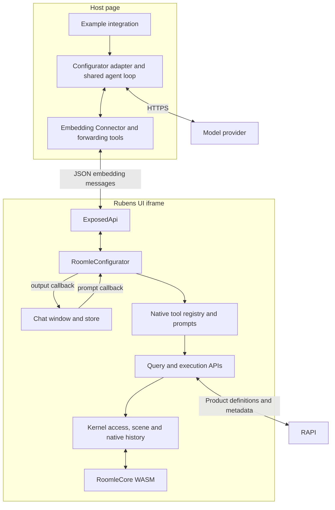
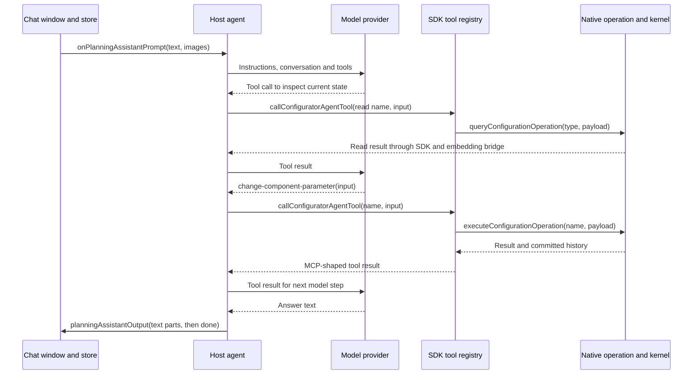

# Configuration Assistant Architecture

How the AI Configuration Assistant takes a prompt from the configurator window through a browser
agent, native SDK tools and RoomleCore, then returns the answer. This page covers the runtime,
ownership, channels, startup, messages, state and extension points. It follows the structure of
the roomle-ui [HI agent architecture](https://github.com/roomle-dev/roomle-ui/blob/feat/configuration-assistant/.agents/homag-intelligence/agent-architecture.md).

Related references own the details below this layer:

- [SDK API overview](roomle-configurator-api-for-mcp.md): native-operation lifecycle, context and source map.
- [Query API](query-configuration-operation.md) and [execution API](execute-configuration-operation.md):
  operation names, payloads, result fields and committed history.
- [Capabilities](get-configurator-capabilities.md): catalog discovery and declared/current choices.
- [Example integration](configurator-example-with-planning-assistant-chat.md): launcher, page options and helper selection.
- [Assistant guide](../../docs/configurator-assistant.md): running the example and deployment compatibility.

Source paths in this page belong to roomle-ui unless another repository is named. Source links
point to its `feat/configuration-assistant` branch. This reference is maintained in
roomle-configurator-mcp alongside the example.

## Runtime and ownership

The assistant runs in the browser. In the example, the embedding host owns the model and
conversation, while the iframe owns the chat window, tools and live configuration.
A UI-managed startup can run the same agent beside the SDK in the configurator browsing context.

| Part | Runs in | Owns |
|---|---|---|
| Example page and launcher | Browser host and local Node process | Embedding, local model configuration and starting the host agent |
| `PlanningAssistantChat.vue` and its Pinia store | Rubens UI | Input, displayed entries, availability and busy state |
| Configurator adapter and shared agent loop | Host page, or the UI for UI-managed startup | Provider connection, model conversation, tool forwarding and interrupted-turn summaries |
| `RoomleConfigurator` and its tool registry | Configurator SDK | Tool definitions, prompts, validation and dispatch to native operations |
| Kernel access, scene manager and history | Configurator SDK with RoomleCore WASM | Current product state, evaluation, rendering and undo/redo |

The tools use MCP-shaped definitions and results. Discovery and calls are ordinary SDK methods
over the existing embedding channel. The static launcher serves HTML and model configuration;
there is no MCP protocol endpoint or separate chat backend. An external MCP client cannot connect
to the example directly. [ADR 0002](../decisions/0002-configurator-tools-run-in-the-sdk.md)
defines the ownership boundary.

## Components

The embedded example has this arrangement:



UI-managed startup puts the adapter and loop inside the UI and supplies the live SDK object
directly. It uses the same tool and window interfaces without an embedding hop between the agent
and SDK.

## Roles

### Chat window and store

[PlanningAssistantChat.vue](https://github.com/roomle-dev/roomle-ui/blob/feat/configuration-assistant/src/common/components/PlanningAssistantChat.vue)
renders the conversation and sends `PlanningAssistantPrompt`. It knows no provider, model or tool
implementation.

The standalone configurator's
[ConfiguratorMain.vue](https://github.com/roomle-dev/roomle-ui/blob/feat/configuration-assistant/src/configurator/components/ConfiguratorMain.vue)
shows its trigger when `featureFlags.configurationAssistant` is enabled and the SDK has no planner.
The window heading is **AI Configuration Assistant**. The planner has its own window, controlled
by `featureFlags.planningAssistant`.

Enter sends text after image preparation completes; IME composition does not send. Voice input
puts a transcript in the input for review. Image drop is enabled only when the agent sends the
corresponding output part. The example and UI-managed startup both set `readsImages: false`.
Answers render as sanitized Markdown; failed answers render as text.

The [planning-assistant store](https://github.com/roomle-dev/roomle-ui/blob/feat/configuration-assistant/src/common/store/planning-assistant-store.ts)
owns displayed entries, `busy`, `activity`, `available`, `availabilityText` and `imagesEnabled`.
It starts unavailable. `send` refuses empty input, an unavailable assistant or a running turn;
otherwise it appends the user entry and an empty answer, marks the turn busy and fires the prompt.

`firePrompt` calls `onPlanningAssistantPrompt` on the application SDK: the configurator in a
standalone configurator, the planner when the UI has a planner. The component does not await the
turn. `receive` applies output parts to the running answer. Closing the configurator drawer
unmounts the component; the Pinia entries and agent conversation have their own longer lifetimes.

### Configurator adapter and shared agent loop

The optional `@roomle/embedding-lib/configurator` entry exports
`startConfiguratorPlanningAssistant`, `createConfiguratorMcpTools` and `loadChatModel`.

The [configurator assistant adapter](https://github.com/roomle-dev/roomle-ui/blob/feat/configuration-assistant/packages/embedding-lib/src/configurator-agent/configurator-planning-assistant.ts)
takes `{ configurator, window }`, a `PlanningAssistantConfig` and an `AbortSignal`.
`configurator` supplies prompts and tools; `window` supplies the prompt callback slot and output
method. Separating them supports native planner isolation:

| Integration | `configurator` | `window` |
|---|---|---|
| Embedded configurator | `instance.extended` | `instance.extended` |
| Native object in planner isolation | `instance.configurator` | `instance.extended` |
| UI-managed configurator | Live `RoomleConfigurator` | Same live `RoomleConfigurator` |

The adapter loads prompts and forwarding tools together, then delegates to the
[shared startAssistant loop](https://github.com/roomle-dev/roomle-ui/blob/feat/configuration-assistant/packages/embedding-lib/src/planning-assistant/planning-assistant.ts).
That loop owns the model conversation, streaming, step limit and output. The configurator adapter
adds its five-minute turn deadline and recovery policy. HI adapters reuse the loop with their own
domain setup.

The [provider loader](https://github.com/roomle-dev/roomle-ui/blob/feat/configuration-assistant/packages/embedding-lib/src/planning-assistant/chat-model.ts)
loads the AI SDK/provider modules on demand from CDNs. Provider calls run in the agent's browsing
context, using its supplied credentials. Supported configuration fields are in
[Message formats](#message-formats); launcher aliases and version pins stay in the
[example reference](configurator-example-with-planning-assistant-chat.md).

### Forwarding tools and validation

The embedding-lib's
[createConfiguratorMcpTools](https://github.com/roomle-dev/roomle-ui/blob/feat/configuration-assistant/packages/embedding-lib/src/configurator-agent/configurator-mcp-tools.ts)
reads definitions once with `getConfiguratorAgentTools()`. The
[shared tool adapter](https://github.com/roomle-dev/roomle-ui/blob/feat/configuration-assistant/packages/embedding-lib/src/planning-assistant/mcp-tools.ts)
creates one AI SDK dynamic tool per definition, preserving descriptions, JSON Schemas and annotations.

Each dynamic tool calls `callConfiguratorAgentTool(name, input)`. Its Standard Schema validation
passes the input through because the SDK performs authoritative validation. A rejected forwarding
call becomes a tool result with `isError: true`. `toModelOutput` maps text content to model text
and image content to file parts. Creating forwarding tools alone imports no model SDK.

The configurator SDK's
[shared mcpTool primitive](https://github.com/roomle-dev/roomle-ui/blob/feat/configuration-assistant/packages/web-sdk/packages/common-core/src/agent-tools/mcp-tool.ts)
exports the input schema as draft-7 JSON Schema and validates calls with Zod.
Invalid arguments return an MCP-shaped `-32602` error; handler exceptions become error text with
`isError: true`. Schema parsing also removes extra top-level docking-pair fields before dispatch;
the [direct execution API](execute-configuration-operation.md#docking-and-moving) has its own
payload contract.

### SDK agent methods, registry and prompts

[RoomleConfigurator](https://github.com/roomle-dev/roomle-ui/blob/feat/configuration-assistant/packages/web-sdk/packages/configurator-core/src/roomle-configurator.ts)
provides these methods:

| Method | Responsibility |
|---|---|
| `getConfiguratorAgentTools()` | Return tool names, descriptions, JSON Schemas and annotations |
| `callConfiguratorAgentTool(name, input)` | Execute the named SDK tool and return its MCP-shaped result |
| `getConfiguratorAgentPrompts()` | Return `systemPrompt` and `imagePrompt` |
| `planningAssistantOutput(part)` | Deliver a part through `onPlanningAssistantOutput` to the UI |

The registry initializes on the first tool request, is cached per SDK instance, and clears a failed
initialization so the next request can retry. Discovery requires no loaded product. Executing
native operations requires the [active configuration](roomle-configurator-api-for-mcp.md#shared-lifecycle-and-serialization).
Enumerating exposed SDK methods does not initialize tools.

The registry and input schemas live in `configurator-core/src/configurator-mcp/`.
It registers eight reads, six writes, undo and redo. The
[operation catalogs](roomle-configurator-api-for-mcp.md#documentation-map) map those tools to
native queries and writes. Registry handlers invoke those methods on the same SDK instance.

[agent-prompts.ts](https://github.com/roomle-dev/roomle-ui/blob/feat/configuration-assistant/packages/web-sdk/packages/configurator-core/src/configurator-mcp/agent-prompts.ts)
loads separately. Its instructions tell the model to inspect current choices, distinguish them
from declared alternatives, acknowledge unresolved resources, use queried placements and report
changes from tool outcomes. Product-specific choices come from the live product data.

### Native operations and kernel

The tool handlers call the two generic APIs documented in the
[SDK overview](roomle-configurator-api-for-mcp.md). These dynamically load
`common-core/src/mcp-api/configuration-operations.ts`, which owns validation, session capture and
operation ordering. Product discovery uses SDK RAPI access and kernel-evaluated choices.

Native edits pass through `ConfiguratorKernelAccess` to RoomleCore's embind methods.
The existing scene manager processes kernel updates and records serialized configurations in
`ConfiguratorHistory`. For example,
[planObjectUpdated](https://github.com/roomle-dev/roomle-ui/blob/feat/configuration-assistant/packages/web-sdk/packages/configurator-core/src/webgl/configurator-scene-manager.ts#L1742)
pushes the updated configuration/hash when a docking is not pending, or updates the current entry
for an automatic calculation update.

The operation reads committed history inside its execution chain; the registry adapts that
outcome for the model. The complete contract, including no-ops, replacement, undo and redo, lives
in [History and completion](execute-configuration-operation.md#history-and-completion).
The browser agent does not maintain a second product-history ledger.

## Channels and embedding handshake

The embedding transport consists of
[MessageHandler](https://github.com/roomle-dev/roomle-ui/blob/feat/configuration-assistant/packages/common/src/utils/message-handler.ts),
the host's [Connector](https://github.com/roomle-dev/roomle-ui/blob/feat/configuration-assistant/packages/embedding-lib/src/connector.ts)
and the iframe's [ExposedApi](https://github.com/roomle-dev/roomle-ui/blob/feat/configuration-assistant/src/configurator/embedding/exposed-api.ts).

A request is a JSON string `{ message, args }` posted with a transferred `MessagePort`.
Each call has its own `MessageChannel`; the reply is `{ result }` or `{ error }`, and the ports
close after the answer. All cross-frame arguments and results must survive JSON serialization.

| From → to | Mechanism | Data |
|---|---|---|
| Chat window → agent | `onPlanningAssistantPrompt`; forwarded to the host in the embedded example | Trimmed text and image data URLs |
| Agent → configurator SDK | `extended.<method>`, or `configurator.<method>` for isolation tools | Prompt/tool discovery and tool calls |
| Agent → application SDK → chat window | `planningAssistantOutput`, then the UI-only `onPlanningAssistantOutput` callback | Text, activity, errors, completion and availability |
| Registry → native operations | Direct calls on the same `RoomleConfigurator` | Typed query/operation payloads and results |
| SDK → RAPI | SDK resource requests | Component/item definitions and material metadata |
| SDK ↔ RoomleCore | Embind calls and kernel callbacks | Configuration, parameters, docking and product updates |
| Agent → model provider | Browser HTTPS through the provider SDK | Instructions, conversation, tool definitions and results |

For UI-managed startup the prompt, tool and output calls use local objects instead of crossing
the iframe boundary. Native product data is resolved by the SDK; it uses no HI `connect_hi`
library channel.

The embedding handshake proceeds as follows:

1. `requestBoot` supplies init data to the iframe.
2. `setup` announces exposed SDK methods and callbacks. Public methods are enumerated; private
   names beginning with `_` are excluded.
3. `Connector.handleSetup` creates host proxy methods and callback slots.
4. `websiteReady` finishes the host/UI handshake.

In a configurator the application SDK is exposed as `extended`; a planner also exposes its inner
configurator as `configurator`. The host overwrites its `onPlanningAssistantPrompt` slot with the
turn handler. The iframe chains callback forwarding through its UI connector.
`onPlanningAssistantOutput` is UI-only: it is neither announced nor forwarded to the host, which
prevents output from being echoed back across the bridge.

## Startup

### Agent owner

The example and UI-managed startup supply the same assistant with different endpoints and
configuration. Choose one owner for a window's prompt callback.

- **Example host:** the page creates the iframe and loads the object, then starts the assistant
  with the locally fetched model config. Its provider key is passed to the host helper, rather
  than included in the iframe's init options. Page ordering and helper selection are documented
  in [the example integration](configurator-example-with-planning-assistant-chat.md).
- **UI-managed configurator:** after SDK initialization and callback registration,
  [SdkConnectorConfigurator.init](https://github.com/roomle-dev/roomle-ui/blob/feat/configuration-assistant/src/configurator/business-logic/sdk-connector-configurator.ts#L93)
  starts the assistant when there is no planner, `configurationAssistant` is enabled and init
  data contains a non-blank `apiKey`. It uses OpenAI, `configurationAiModel` or the default
  `gpt-6-luna`, and disables images. Agent setup runs without holding up configurator
  initialization. This path is controlled by those init inputs; it has no separate embedded-page
  check.
- **Native planner isolation:** the host explicitly supplies the inner configurator for tools
  and the planner for the window. Planner initialization does not auto-start this native agent.

Both the example and UI-managed path abort their assistant signal on `pagehide`.
The feature flag exposes the window; usable model configuration and completed setup make the
input available.

### Assistant setup

`startAssistant` loads three things concurrently: the AI SDK, the provider model and the
configurator domain. Domain setup concurrently requests prompts and creates forwarding tools.

After all succeed, it creates an empty model conversation, installs the prompt handler, sends
`{ type: 'images', enabled: config.readsImages }` and then reports availability.
A setup failure reports `availability: false` with the reason instead of enabling input.
An older UI without native agent tools reports `Update the Rubens UI: configurator agent tools are unavailable.`

## A prompt from end to end

For a request such as "Change this component's finish", the model inspects the current configuration
and parameters, chooses a supported value, performs the edit and answers from the tool result.
The exact tool sequence is model-selected; the following shows one parameter write.



1. **Send.** The store appends display entries and fires the application SDK's prompt callback.
   In the embedded example, the iframe's `ExposedApi` forwarder posts
   `extended.callbacks.onPlanningAssistantPrompt`. The host's `MessageHandler` and
   `Connector.executeMessage` invoke the registered turn handler. The reply port stays open until
   that handler settles.
2. **Start the turn.** The handler builds a user message from text and any JPEG files. Empty text
   uses the SDK's `imagePrompt`. It creates recovery tracking and a turn abort controller.
3. **Run the model.** `streamText` receives the SDK's `systemPrompt` as instructions, the retained
   messages plus the new message, and the forwarding tools. Text deltas and tool calls generate
   UI output while the stream runs.
4. **Execute a tool.** The dynamic tool calls `extended.callConfiguratorAgentTool(name, input)`.
   The host `Connector` sends that command through `MessageHandler`; the iframe's
   `ExposedApi._handleMessage` dispatches it to `RoomleConfigurator.callConfiguratorAgentTool`.
   The SDK looks up the tool, validates its input and invokes its native-operation handler.
   A parameter write resolves the live component/key and calls
   `ConfiguratorKernelAccess.setComponentParameter`, which invokes the kernel's
   `setComponentParameter` binding.
5. **Report the edit.** The SDK operation returns its resulting hash and committed history.
   The tool adapts the result using the [execution contract](execute-configuration-operation.md#history-and-completion).
   `ExposedApi` answers on the request's port with `{ result: McpToolResult }`. The host's proxy
   resolves, and the model adapter supplies that result to the next model step.
6. **Finish.** Each output part travels through `extended.planningAssistantOutput`,
   `ExposedApi`, `RoomleConfigurator.planningAssistantOutput` and the UI connector's
   `onPlanningAssistantOutput` handler to `store.receive`. On success, the loop retains the user
   message and model response messages, including tool calls/results, then sends `done`.
   The store clears busy/activity. The prompt handler settles and the original callback request
   completes.

UI-managed startup follows the same steps with direct SDK calls. In isolation, tools go to the
inner configurator while prompt and output use the planner's window.

## Message formats

### Prompts and UI output

The shared
[planning-assistant types](https://github.com/roomle-dev/roomle-ui/blob/feat/configuration-assistant/packages/web-sdk/packages/common-core/src/planning-assistant.ts)
define `PlanningAssistantPrompt` as `{ text: string, images: string[] }`.
The UI trims text and prepares JPEG data URLs; an enabled image input scales the longest edge to
at most 1568 pixels. The type and callback names retain `PlanningAssistant` for both native and
HI windows.

Each `PlanningAssistantOutput` call carries one part:

| Part | Store action |
|---|---|
| `{ type: 'text', text }` | Append streamed Markdown to the running answer |
| `{ type: 'activity', text }` | Set the current activity, such as a tool name |
| `{ type: 'error', text }` | Replace the answer, mark it failed and end the turn |
| `{ type: 'done' }` | End the turn and clear activity |
| `{ type: 'availability', available, text? }` | Enable/disable sending; becoming unavailable also fails a running answer |
| `{ type: 'images', enabled }` | Enable/disable image input |

Text, activity, error and done parts without a running answer are ignored.
The loop sends output parts without awaiting each SDK output call.

### Tool and embedding messages

`AgentToolDefinition` carries `{ name, description, inputSchema, annotations? }`.
`McpToolResult` carries `content` and optional `isError`. Text content is
`{ type: 'text', text }`; image content is `{ type: 'image', data, mimeType }` with raw base64.
The native registry returns serialized JSON text. Its full query/write results are in the
[API references](roomle-configurator-api-for-mcp.md#documentation-map).

For example, the host forwards a read as this embedding command:

```json
{
  "message": "extended.callConfiguratorAgentTool",
  "args": ["get-configuration", {}]
}
```

The reply envelope is `{ result: McpToolResult }`; a transport/dispatch error uses `{ error }`.
In isolation the tool command has the `configurator` namespace, while output remains
`extended.planningAssistantOutput`.

### Model configuration

`PlanningAssistantConfig` belongs to the shared provider loader:

| Field | Meaning |
|---|---|
| `provider` | `openai`, `azure`, `mistral`, `anthropic` or `google` |
| `model`, `apiKey` | Provider model ID and credential; Azure uses its deployment name |
| `readsImages` | Whether setup enables image input |
| `baseUrl`, `chatCompletions`, `reasoningEffort` | Optional Azure endpoint, API-selection and reasoning options |

The browser sends conversation and tool data to the chosen provider. Model config and credentials
live with the agent owner; launcher credential serving is documented in the
[example integration](configurator-example-with-planning-assistant-chat.md).

## Concurrency, deadlines and errors

The store permits one user turn at a time. The shared loop installs one callback but adds no
second prompt queue; callers invoking the callback directly must preserve that turn ordering.

The model can issue tools together. Native reads and writes join the SDK's
[operation chain](roomle-configurator-api-for-mcp.md#shared-lifecycle-and-serialization).
The forwarding layer adds no per-tool timeout or queue. Direct UI edits still use the live product;
freshness and native undo behavior are defined by the operation APIs.

A turn has at most sixteen model steps. Step sixteen disables tools so the final step answers.
The configurator adapter applies a five-minute deadline to each turn and combines it with the
owner's abort signal. A deadline abort ends that turn; `pagehide` aborts the owner signal too.
The deadline timer and abort listener are removed when the turn settles.

The deadline bounds the agent/model work. The tool signature sends no abort signal to a native
SDK operation already dispatched; interruption does not cancel or roll back that mutation.
Inspect live state before repeating an uncertain write.

| Failure | Where it is reported |
|---|---|
| Missing model, failed provider/module setup or unavailable tools | Window availability with a reason |
| Unknown tool, invalid input, native-operation failure or rejected forwarding | `McpToolResult.isError`, visible to the model |
| Provider/stream failure, owner abort or turn deadline | Window error part with an interrupted-turn summary |
| Partial catalog metadata | Successful capability result; see [capability semantics](get-configurator-capabilities.md#read-semantics) |

### Interrupted-turn recovery

[createChatRecovery](https://github.com/roomle-dev/roomle-ui/blob/feat/configuration-assistant/packages/embedding-lib/src/configurator-agent/chat-recovery.ts)
wraps the turn's tools and records pending, returned and thrown outcomes independently of whether
the model finishes the step.

| Recorded outcome | Summary |
|---|---|
| No tool ran | The turn made no tool changes |
| Completed or incomplete read | Describes returned/missing information and says the read changed no configuration |
| Successful write | Includes its returned confirmation/history facts |
| Write with `confirmed: false`, an error or a pending result | Marks the edit unconfirmed and asks for inspection before retrying |
| Undo/redo | Retains the tool's `undone`/`redone` facts and availability |

A successful turn retains structured model response messages. A failed turn instead retains the
user message and a readable assistant summary. This avoids orphaned tool-call/result pairs and
does not dump large read payloads into the summary. The UI error replaces any partial answer.
Recovery reports recorded outcomes; it never automatically repeats a tool operation.

## Where state lives

| State | Owner | Lifetime |
|---|---|---|
| Model conversation and provider config | `startAssistant` closure in the agent owner | That assistant invocation |
| Pending/returned tool outcomes and deadline | Per-turn recovery wrapper and abort controller | One turn |
| Displayed entries, busy, activity and availability | UI Pinia planning-assistant store | UI app |
| SDK tool set | `RoomleConfigurator._configuratorAgentTools` | SDK instance |
| Serialized operation ordering | `configuration-operations.ts` module's shared promise chain | Loaded module |
| Product resources and capability discovery | SDK RAPI access and capability collector | Resource-cache and collection lifetimes |
| Active configuration and evaluated choices | Native SDK context and RoomleCore | Loaded native configuration |
| Undo/redo configurations and current index | `ConfiguratorHistory`, accessed through the scene manager | Native configurator history |

Chat display entries are separate from the conversation sent to the model. Closing the drawer
does not stop the agent or clear native history. Reloading the page creates new browser state.

## Where a change goes

| Change | Owner/source | Delivered by |
|---|---|---|
| Chat presentation or output application | UI chat component/store and shared output types | roomle-ui deployment; senders must understand new part types |
| Tool schema, description or registration | `configurator-core/src/configurator-mcp/` | roomle-ui SDK deployment |
| System/image instructions | `configurator-mcp/agent-prompts.ts` | roomle-ui deployment |
| Query/write semantics, resource resolution or committed history | Operation implementation, kernel access and native scene/history services | SDK deployment and RoomleCore build when kernel behavior changes |
| Agent loop, providers or model-output conversion | `packages/embedding-lib/src/planning-assistant/` | Embedding-lib release for published hosts; UI build for UI-managed startup |
| Native forwarding, deadline or recovery policy | `packages/embedding-lib/src/configurator-agent/` | Same embedding/UI integration path |
| UI-managed startup inputs and callback registration | `src/configurator/business-logic/sdk-connector-configurator.ts` | roomle-ui deployment |
| Example URL options, model selection, local serving or startup order | This repository's page/launcher | Example deployment |

The API overview's [source map](roomle-configurator-api-for-mcp.md#source-map) locates operation and
kernel code. The example's dev helper can exercise local embedding changes; published hosts need
a compatible UI and embedding version as described in the [guide](../../docs/configurator-assistant.md).

## Tests that guard the path

Paths below belong to roomle-ui unless prefixed with this repository.

| Part | Tests |
|---|---|
| Chat input and store transitions | [PlanningAssistantChat.spec.ts](https://github.com/roomle-dev/roomle-ui/blob/feat/configuration-assistant/tests/integration/common/components/PlanningAssistantChat.spec.ts), [planning-assistant-store.spec.ts](https://github.com/roomle-dev/roomle-ui/blob/feat/configuration-assistant/tests/unit/common/store/planning-assistant-store.spec.ts), [planning-assistant-image.spec.ts](https://github.com/roomle-dev/roomle-ui/blob/feat/configuration-assistant/tests/unit/common/utils/planning-assistant-image.spec.ts) |
| Configurator and isolation namespaces, UI-only output callback | [exposed-api.spec.ts](https://github.com/roomle-dev/roomle-ui/blob/feat/configuration-assistant/tests/unit/configurator/embedding/exposed-api.spec.ts) |
| UI-managed startup conditions, model selection and abort | [sdk-connector-configurator.spec.ts](https://github.com/roomle-dev/roomle-ui/blob/feat/configuration-assistant/tests/unit/configurator/business-logic/sdk-connector-configurator.spec.ts) |
| Separate endpoints, conversation, deadline and forwarding errors | [configurator-planning-assistant.spec.ts](https://github.com/roomle-dev/roomle-ui/blob/feat/configuration-assistant/tests/unit/embedding-lib/configurator-agent/configurator-planning-assistant.spec.ts) |
| Actual AI SDK tool conversion, committed result and invalid input | [configurator-stream-text.spec.ts](https://github.com/roomle-dev/roomle-ui/blob/feat/configuration-assistant/tests/unit/embedding-lib/configurator-agent/configurator-stream-text.spec.ts) |
| Interrupted read/write/history summaries | [chat-recovery.spec.ts](https://github.com/roomle-dev/roomle-ui/blob/feat/configuration-assistant/tests/unit/embedding-lib/configurator-agent/chat-recovery.spec.ts) |
| Native registry, queries, writes and history | SDK tests linked from the [API source map](roomle-configurator-api-for-mcp.md#source-map) |
| Example startup and local launcher | This repository's [example.test.js](../../minimal-configurator-example/tests/example.test.js) and [start.test.js](../../minimal-configurator-example/tests/start.test.js) |

Browser acceptance follows the [integration skill](../skills/configurator-assistant.md#tests):
discovery, a changed edit, an unchanged edit, undo/redo and a direct SDK edit followed by agent undo.
