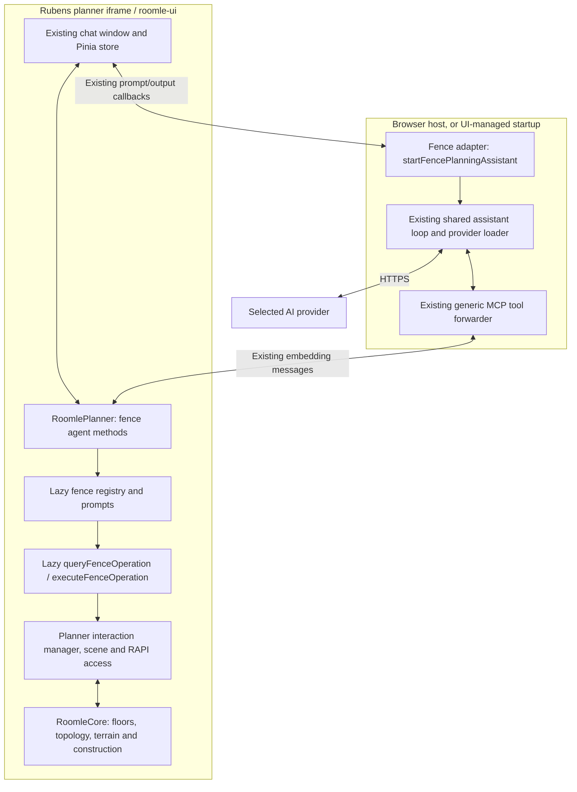

# Fence Assistant: terrain generation, loading and manipulation

**Status:** Implemented — feature branches; not landed

**Date:** 2026-10-24

**Ticket:** [RML-18302 — research fence assistant](https://roomle.atlassian.net/browse/RML-18302)

**Scope:** Feature analysis and implementation record. The terrain-focused implementation is complete on feature branches. This repository is prepared for pull-request review; the matching roomle-ui and RoomleCore changes remain local. No package is published and no implementation is deployed. Sections 1–18 retain the original investigation and proposed acceptance scope; section 19 records the delivered contract, checks and remaining limits.

## Affected repositories

- **roomle-configurator-mcp:** this analysis and its indexes; the implementation extends the minimal fence example with assistant startup and local model configuration.
- **roomle-ui:** planner operation APIs, lazy Fence Assistant tools and prompts, embedding adapter, automatic UI startup, existing chat integration and tests. The Web SDK and embedding library are packages of this repository.
- **RoomleCore:** only missing terrain-contour and undo-aware corner-height primitives, plus thin bindings for existing model reads, sampling, curve knots and history. Context assembly, batches, splitting/removal orchestration and all assistant tools remain in lazy roomle-ui modules.

roomle-hi-example is an architectural reference, not an implementation dependency. No HI library, HI callback setup or HI backend is required for native terrain planning.

## Implementation boundary after scope review

The implementation is UI first. Tool schemas, prompts, JSON terrain context, operation
validation, split/removal orchestration and corner batches are dynamically imported
TypeScript modules in roomle-ui. Ordinary planner startup imports no fence registry or
model provider. Core supplies its existing terrain engine and two missing primitives:
deterministic typed contour creation and an undo-aware independent corner setter.
Thin bindings expose existing boundary nodes, effective heights, authoritative sampling,
curve knots and history cursor/size. No native terrain DTO hierarchy, context assembler,
split/removal APIs, batch-height API or AI registry is added.

Synchronous edits use the existing interaction hold/release in one call stack and return
a detached result before yielding. Native plan IDs identify replacement; JavaScript
wrapper identity is not stable. Dependent construction completion is conservatively
reported pending when potentially affected objects exist. The adapter does not invent
an aggregate completion signal, wait on a timer, or claim every fence/BOM update finished.
Native redistribution still runs. Adding a general producer batch-completion contract
is separate from this terrain-focused version.

The reviewed implementation plan is [Jira comment 156501](https://roomle.atlassian.net/browse/RML-18302?focusedCommentId=156501), updated with these boundaries.

## 1. Request and conclusions

The Fence Assistant must plan both terrain and fences. This analysis concentrates on terrain: loading an existing plot, generating a plot from dimensions or an outline, changing its boundary, shaping slopes and steps, changing appearance, and preserving the ordinary planner history. Fence placement is included where terrain edits affect existing construction; a complete fence-authoring tool catalog is a separate feature question.

**Required activation:** automatically start the Fence Assistant in planner mode when `featureFlags.planningAssistant === true`, `featureFlags.fence === true`, and a non-empty `apiKey` is supplied. A visible chat panel alone is not an activated assistant. The startup must load the implementation on demand. There is no additional `fenceAssistant` flag.

The main findings are:

1. **Terrain is already a kernel feature.** A terrain is a `Floor` of type `TERRAIN`, bounded by ordinary terrain nodes and zero-height, zero-thickness `EDGE` walls. It is not a configurable product or an HI group.
2. **Terrain relief belongs to each floor corner.** Two patches can share the same node and have different heights there. The assistant must distinguish a shared-node height edit from a floor-specific corner edit.
3. **Some useful public SDK methods exist.** Loading, node-height edits, boundary length edits, undo/redo, snapshots and images can be reused. They do not yet form a complete, plain-data terrain authoring API.
4. **The missing boundary is primarily an SDK operation API and its DTOs.** Add `queryFenceOperation` and `executeFenceOperation` to `RoomlePlanner`, with implementation loaded through dynamic imports. Tools call those operations on the same live planner.
5. **Some kernel API work is necessary for the complete feature.** In particular, there is no public handler/binding for setting one floor's corner height. Deterministic terrain construction must also avoid interactive drawing's automatic switch into the fence domain.
6. **Reuse the assistant architecture.** Use the existing chat component/store, embedding messages, neutral tool adapter, provider loader and shared browser agent loop. Add the fence domain beside the configurator and HI domains.
7. **Loading and editing have different history contracts.** Loading a plan replaces the plan/history. Creating or editing terrain inside an existing plan should make one ordinary planner undo step per successful operation; a no-op should make none.

The API/tool names and gaps in the investigation below describe the pre-implementation baseline. Section 19 and the living references describe the implemented surface. Source observations and runtime observations are identified separately.

## 2. Evidence and examined revisions

| Repository | Examined revision | Relevant state |
|---|---|---|
| roomle-configurator-mcp | `ec1b362f428aee694265b47a03b3eeb93ad9026e` | Master includes the minimal Biohort fence example |
| roomle-ui | `d8a3693a0e2548602aefde42ca6596cbe89de3cb` on `feat/configuration-assistant` | Configurator and HI assistant implementations used for comparison |
| RoomleCore | `2be086b028420e5ff4fb0ac6b08d87161aa5846c` | Per-floor corner heights and floor levels are present |

The RoomleCore checkout and the deployed UI are distinct versions. The deployed browser probe verifies existing node-height editing; it does not demonstrate that the deployed WASM includes the newer per-floor height model or any proposed API.

### 2.1 Ticket data

The ticket was read with the Jira CLI, including comments. Its Biohort snapshot was refreshed using `npm run rapi:plan -- ps_mpzobaibjtz9034jbpurb6t98fab0w8` in RoomleCore's `node/`.

The temporary download contains four boundary nodes, four `type="edge"` edges, one `type="terrain"` floor and no plan objects. The plot is **10,000 × 7,500 mm**, flat at zero, with **75 m² projected area**. Its material is a custom green colour. The download reports zero components and meshes because this snapshot contains no fence products. These downloaded resources remain ignored and are not committed.

`roomle-configurator-mcp/minimla-fence-example/index.html:72` creates the planner with embedding ID `biohort_fence`, root tag `biohort_fence_root`, and this snapshot. It exposes `window.instance` after `ui.loadObject` resolves. The example currently has exports but no assistant startup or model configuration route.

### 2.2 Browser verification

A temporary Playwright probe loaded the existing example against `https://www.roomle.com/t/cp/`, then used the public embedding API:

| Action | Observed result |
|---|---|
| Load the Biohort snapshot | One flat floor; projected area `75000000` mm²; no objects |
| Read `getPlanOverview()` | Area, bounds, room runtime ID, material and aggregated wall areas; no editable terrain node/edge graph |
| Call `setNodeZCoordinate(nodeId, 500)` | One boundary corner becomes 500 mm high; undo becomes available |
| Call `undo()` | All four corner heights return to zero; redo becomes available |
| Call `redo()` | The same corner returns to 500 mm |
| Undo the probe edit | Initial terrain is restored |

No browser page errors were captured. The loaded runtime IDs included floor `25` and edited node `12`; these are observations from that session, never constants for the implementation. The probe used only a temporary browser session and did not save the edited plan to RAPI.

The public method list included `getPlanOverview`, `drawWalls`, `setWallMeasurementLength` and `setNodeZCoordinate`. It contained no proposed Fence Assistant agent methods. The deployed floor had no serialized `level` property in the probe result, reinforcing the version distinction above.

## 3. What terrain means in the current model

### 3.1 Topology, patches and construction are separate concepts

| Concept | Current owner and representation | Consequence for the assistant |
|---|---|---|
| Terrain boundary node | `planner::Node`, normal node domain | Address by live runtime ID; distinguish from construction nodes at the same position |
| Terrain boundary/divider | `planner::Wall` with `EdgeType::EDGE`, zero height/thickness | It describes ground topology, not a physical wall or fence span |
| Terrain patch | `planner::Floor` with `FloorType::TERRAIN` | Owns its boundary, material and corner heights |
| Connected ground area | Floor cluster derived from adjacency | Query returns patch membership; a cluster is not a persistent editable entity with a stable ID |
| Fence span | `EdgeType::CONSTRUCTION` | Separate domain; do not retype it or merge it into terrain |
| Fence post/module/door | Native construction objects/configurations | Kernel distribution adapts them to the terrain profile |
| Surface mesh | Cached triangulation derived from the floor boundary | Generated output; never authored by the agent |

`RoomleCore/src/planner/geometry/plan-geometry.cpp:2157` classifies a floor from its surrounding edges. `src/planner/geometry/plan-floor-constructor.cpp:388` walks node chains and creates floors; it explicitly excludes construction edges at line 394. At lines 445–454 it creates a floor, classifies it, inherits the overlapping floor's parameters and seeds missing corner heights.

`RoomleCore/src/planner/geometry/plan-geometry.cpp:754` derives adjacency from walls' left and right floor references; `findFloorClusters` at line 820 collects connected floors. It is a general floor clustering API. Terrain queries must filter floor types rather than label every returned cluster as terrain. roomle-ui already applies such filtering in `planner-core/src/utils/terrain-helper.ts:96`.

### 3.2 Relief is per floor, not one Z per node

`RoomleCore/src/planner/model/floor.cpp:695` reads `Floor::getHeightAt(node)`. `setLevel` at line 713 shifts all corner heights by a common difference and clamps the requested minimum level to zero or above. `setHeightAt` at line 727 changes only the selected floor's height at that node. `heightsChanged` at line 749 invalidates the surface and refreshes affected geometry.

This implements [ADR 0100](https://github.com/roomle-internal/RoomleCore/blob/2be086b028420e5ff4fb0ac6b08d87161aa5846c/.agents/decisions/0100-a-floor-owns-the-heights-of-its-corners.md). A shared node does not identify a unique surface height.

For example, the same node can belong to a lower patch at 0 mm and an upper patch at 400 mm. These are different intended edits:

- **Raise the shared terrain node by 100 mm:** the two patch heights become 100 and 500 mm; the existing step is preserved.
- **Set the upper patch's corner to 600 mm:** the lower patch remains at 0 mm; the step changes locally.
- **Set the upper patch's level to 600 mm:** every corner of that patch shifts together; its internal relief remains unchanged.

`RoomleCore/src/planner/interaction/move-element.cpp:500` and `:529` implement shared-node height displacement. Only incident terrain floors are shifted. The floor-specific alternative exists in the model but lacks a handler and web binding. The existing backlog item is `RoomleCore/.agents/backlog/floor-corner-height-editing-api.md`.

The terrain DTO must therefore expose both the node position/seed and each floor's effective corner heights. Reporting only `Node.getCenter().z` would lose steps and mislead later edits.

### 3.3 Surface generation and height sampling

`RoomleCore/src/planner/model/floor.cpp:808` lazily creates a `TerrainContourConstructor`. Its `generateContours` at `src/planner/geometry/terrain-contour-constructor.cpp:208` reads the floor corners, derives an outline, decomposes the boundary by height and triangulates the sub-polygons. The kernel owns the surface, interpolation and cache invalidation.

This is boundary-based terrain relief, not a general surveyed point-cloud or raster heightmap import contract. An interior hill, valley or grade break needs additional topology/patch boundaries to supply interior height controls. Adding a mesh in Three.js would not create terrain the kernel can sample for fences.

`RoomleCore/src/planner/geometry/plan-intersection.cpp:617` implements terrain height sampling: containment first, then nearest boundary within **250 mm**, then no terrain result. The plan-wide convenience at line 689 returns the supplied point unchanged when no ground height is resolved. Consequently, a returned Z of zero does not by itself prove that a query hit terrain.

The proposed height-query API must retain hit/miss and selected-patch information. At a step, a caller must be able to request a particular patch or receive the candidate patch heights. The SDK must not recreate a second interpolator in JavaScript with different triangle or border rules.

### 3.4 Units and coordinate systems

Use one explicit public terrain convention: **millimetres, kernel plan coordinates, X/Y horizontal and Z upward**. Area fields must identify mm² or m² explicitly. User-facing metres/centimetres are converted by the tool/SDK interface, once.

`roomle-ui/packages/web-sdk/packages/common-core/src/utils/kernel-utils.ts:4` converts kernel coordinates to Three.js as `(x/1000, z/1000, -y/1000)`; the inverse begins at line 25. Raw Three.js positions are metres with Y upward and must not be mixed into terrain payloads.

Plan XML is a serialization format with version conversions. `RoomleCore/src/planner/serializer/plan-xml-reader.cpp:337` passes loaded coordinates through `convertPointFromPlanXML`. The probe's loaded Y coordinates differ in sign from the version-2 XML. Tools obtain coordinates and IDs from the live terrain DTO, not by copying XML coordinates or treating stored node UIDs as runtime IDs.

## 4. Existing APIs and their limits

Paths in this section belong to roomle-ui unless stated otherwise.

| Existing API/path | What it provides | Why it is not the complete terrain API |
|---|---|---|
| `RoomlePlanner.loadPlan` at `planner-core/src/roomle-planner.ts:562` | Fetch a plan/snapshot through SDK RAPI access and load its XML | Replaces the whole plan; not an in-place patch edit |
| `loadPlanXml` at `:493` | Load serialized plan data through the scene lifecycle | Resets the plan/history; should not be an LLM-authored mutation format |
| Host `instance.ui.loadObject` | Existing example bootstrap for the snapshot | Not a tool to generate or reshape terrain |
| `getPlanOverview` at `:1251` | Plain overview DTO | No ordered terrain topology, node IDs, patch heights or edge adjacency |
| `getConstructionOverview` at `:1263` | Native construction objects and BOM | Terrain is not a product in the construction BOM |
| `getExternalRoomInformation` at `:3327` | HI-oriented room contour information | Not the complete editable per-floor terrain graph |
| `drawWalls` at `:1608` | Create normal walls from endpoint definitions | Creates ordinary walls first and returns kernel handles |
| `setNodeZCoordinate` at `:2334` | Shared-node height edit through the scene manager | Does not set one floor's corner independently |
| `setWallMeasurementLength` at `:2308` | Horizontal or sloping edge length editing | Needs an explicit length kind and endpoint/extension semantics |
| `moveByRuntimeId` at `:3633` | Move an element by runtime ID through a view model | Requires terrain-specific target semantics and verified outcomes |
| `undo`/`redo` at `:3648`/`:3656` | Ordinary planner history actions | Return void, not agent-readable change/completion facts |
| `saveCurrentPlanSnapshot` at `:2020` | Existing snapshot persistence | Persistence is separate from the in-memory edit/history contract |
| `getPlanInteractionManager` at `:1026` | Access to the low-level manager inside the iframe | Embind/model objects are not a plain JSON embedding contract |

The overview limitation also exists in the kernel DTO: `RoomleCore/src/planner/view/plan-overview.h:89` defines a room with runtime ID, area, bounds, material, aggregated wall areas and objects. It does not contain the editing topology. Its construction DTO at line 106 contains objects and parts.

### 4.1 Why `drawWalls` followed by retyping is unsuitable

`drawWalls` invokes `addNode` and `addWall`, then sets optional wall height and thickness (`roomle-planner.ts:1623`). `RoomleCore/src/planner/interaction/plan-interaction-handler.cpp:1566` delegates `addWall` to `AddElement::addWallFrom`; that constructs and adds a normal wall using defaults (`src/planner/interaction/add-element.cpp:265`).

The real terrain drawing path is different. `WallConstructor` uses `AddElement::addContourEdgeFrom` when making a contour edge permanent (`RoomleCore/src/planner/drawing/wall-constructor.cpp:808`). That service sets **zero height, zero thickness and the final edge type before adding the edge** (`src/planner/interaction/add-element.cpp:295`). The ordering matters for topology construction, mesh creation and overlap cleanup. Retyping a normal wall afterwards is not an equivalent authoring primitive.

### 4.2 Why simulated clicks are only a prototype path

The existing interaction sequence `beginDrawing(CONTOUR)`, `forceNode`, `endDrawing` can generate terrain in an uncomplicated empty plan. However:

- `PlanInteractionHandler::beginDrawing` samples/snaps input onto the terrain when enabled (`RoomleCore/src/planner/interaction/plan-interaction-handler.cpp:2332`). Requested Z cannot simply be assumed to become a new independent corner height.
- `DrawingManager::beginDrawingAndDetectMode` switches to `CONSTRUCTION_CONTOUR` near a construction node/edge (`src/planner/drawing/drawing-manager.cpp:361`). The caller's fallback `CONTOUR` does not force the terrain domain.
- A corner shared by terrain and fence has an existing domain-detection backlog item. An assistant request must not rely on which coincident element wins a closest-point query.
- Drawing has temporary walls, snapping, cancellation and nested history behavior (`src/planner/drawing/click-drawing-manager.cpp:42`). Exposing each click as a model tool would leave partially drawn plans across failed turns.

Use the kernel's construction services through a deterministic typed operation. Do not add a host-side click script as the final authoring API.

## 5. Architecture of the proposed Fence Assistant



For UI-managed startup the adapter receives the live planner object directly; it does not send messages through a loopback iframe bridge. For an embedded host it receives `instance.extended`. Both use the same domain tools, operation contracts and shared agent loop.

### 5.1 What is shared with the existing assistants

| Layer | Configurator / HI implementation | Fence design |
|---|---|---|
| Chat | `PlanningAssistantChat.vue` and planning-assistant store | Reuse; fence-specific title/availability text |
| Prompt/output | `onPlanningAssistantPrompt`, `planningAssistantOutput` | Reuse unchanged |
| Host/iframe transport | `Connector` and `ExposedApi` | Reuse `extended` planner namespace |
| Agent loop | `embedding-lib/src/planning-assistant/planning-assistant.ts` | Reuse `startAssistant` |
| Providers | Shared `chat-model.ts` | Reuse; no provider implementation in the example |
| Tool forwarding | Shared `planning-assistant/mcp-tools.ts` | Reuse `createAgentMcpTools` |
| Input schemas / result shape | `common-core/src/agent-tools/mcp-tool.ts` | Reuse neutral primitive and types |
| Domain registry | Configurator registry or HI registry | New fence registry in planner-core, loaded lazily |
| Domain operations | Configuration operations or HI glue logic | Native terrain/fence operations on the planner |
| History | Configurator history or HI agent ledger over planner history | Ordinary planner history, including manual edits |
| Product rules | Native component definitions / HI library | Native construction definitions and kernel behavior; no Biohort-specific tool rules |

This follows roomle-configurator-mcp's ADR 0002. There is no new MCP HTTP server, WebSocket bridge, terrain backend, copied provider loop or HI dependency.

### 5.2 Exact activation and startup rule

The planner connector owns automatic UI startup after the SDK is initialized and its UI callbacks are registered:

```text
start Fence Assistant automatically when:
  planner SDK is ready
  AND featureFlags.planningAssistant === true
  AND featureFlags.fence === true
  AND apiKey is a string whose trimmed value is non-empty
```

For example, these init options select automatic UI startup:

```json
{
  "featureFlags": { "planningAssistant": true, "fence": true },
  "apiKey": "<provider-api-key>"
}
```

Supply the credential through the existing init-data/configuration path, not a query parameter. The example's local model-config endpoint must retain loopback/Host checks and `Cache-Control: no-store` when added to the fence launcher, following the configurator example.

| planningAssistant | fence | non-empty apiKey | Automatic Fence Assistant |
|---|---|---|---|
| true | true | yes | Starts on demand |
| true | true | no | No model/agent startup; show why it is unavailable |
| true | false | yes | No Fence Assistant; ordinary planner/HI integration retains ownership |
| false | true | yes | Fence planning remains available; no assistant startup |
| false | false | yes/no | No Fence Assistant |

`planningAssistant` controls the planner chat route today (`src/configurator/store/ui-state-store.ts:163`, `src/planner/components/PlannerSidebar.vue:67`). `fence` enables terrain in the interaction manager (`planner-core/src/services/planner-kernel-access.ts:268`) and chooses contour drawing (`planner-scene-event-handler.ts:1756`). Keep those existing meanings.

Use the configurator connector's lazy UI-startup pattern as the reference (`src/configurator/business-logic/sdk-connector-configurator.ts:104`), but add startup to **the planner connector**. Its output callback already feeds the existing store (`src/planner/business-logic/sdk-connector-planner.ts:557`). The planner must not depend on HI availability to activate the native Fence Assistant.

`SdkConnectorPlanner.init` currently initializes the SDK and returns `initPlanner` (`sdk-connector-planner.ts:138`). `initPlanner` finishes registering callbacks before resolving its initialization waiters at line 564. Attach automatic startup to this lifecycle, once per planner instance; a subsequent plan load must not install another prompt callback or reset the model conversation by starting another agent. Reuse `PlanningAssistantChat`'s existing `heading` prop (`src/common/components/PlanningAssistantChat.vue:12`) for **AI Fence Assistant**, rather than creating a second chat component.

The optional host integration remains useful for consumers choosing their provider/configuration. Exactly one owner installs `onPlanningAssistantPrompt`: when the UI starts the assistant from init-data `apiKey`, the example does not start a second host agent. A host-managed integration supplies credentials to its host adapter and omits the UI-startup `apiKey`. No extra mode flag is needed to express these existing ownership choices.

Select a provider/model through the shared configuration contract, with a documented default for UI-managed startup. The current configurator's `configurationAiModel` option is configuration-specific; do not silently assume that name already configures a fence model. The model option/default is a remaining naming decision, not a missing activation condition. A missing key must not trigger provider imports or network requests.

### 5.3 One lazy registry per planner, current plan resolved per call

Add a promise cached on each `RoomlePlanner` instance. On first fence discovery or call, dynamically import the registry; initialize once; clear the rejected promise on failure so a later request can retry. Import prompts separately.

The exact existing pattern is `RoomleConfigurator._getConfiguratorAgentTools` at `configurator-core/src/roomle-configurator.ts:1598` and `RoomlePlanner._getHiAgentTools` at `planner-core/src/roomle-planner.ts:3281`.

The cached registry must close over the planner, not a floor or the initial `Plan` pointer. Loading another plan retains the registry but all subsequent tool execution resolves the new active plan. Discovery itself requires neither a loaded terrain nor a selected product.

## 6. Proposed public roomle-ui API

Expose five methods on `RoomlePlanner`, with type-only references to their contracts in the eager SDK module:

```ts
getFenceAgentTools(): Promise<AgentToolDefinition[]>;
callFenceAgentTool(name: string, input: unknown): Promise<McpToolResult>;
getFenceAgentPrompts(): Promise<{
  systemPrompt: string;
  imagePrompt: string;
}>;

queryFenceOperation(
  type: FenceOperationQueryType,
  payload?: FenceOperationQueryPayload
): Promise<FenceOperationQueryResult>;

executeFenceOperation(
  type: FenceOperationName,
  payload: FenceOperationPayload
): Promise<FenceOperationResult>;
```

The first three match the existing assistant facade. The last two expose the reusable SDK domain contract, analogous to `queryConfigurationOperation` and `executeConfigurationOperation` (`configurator-core/src/roomle-configurator.ts:1639`, `:1664`). Actual implementation types should be discriminated unions or operation-to-payload maps so operation names and payloads remain correlated.

Use the fence domain name because this assistant will also plan fences. Do not introduce a terrain-only transport that later has to compete for the same chat callback. Terrain is the first operation family of the fence domain.

Public methods are enumerated by the existing embedding setup (`src/configurator/embedding/exposed-api.ts:376`) and forwarded by `Connector.handleSetup` (`embedding-lib/src/connector.ts:70`). New JSON methods do not require a second message protocol. Update SDK public type exports and declaration generation, and test enumeration without invoking lazy methods.

### 6.1 Read operations

| Proposed query | Input | Result and responsibility |
|---|---|---|
| `capabilities` | No terrain required | Supported read/write operations, coordinate convention, terrain/fence enabled state, kernel-dependent capabilities and current history availability |
| `terrain` | Optional floor IDs / include sections | Plain terrain topology, patches, heights, materials, cluster membership and affected construction references |
| `terrainHeight` | XY sample points; optional floor IDs | Actual sampled heights or miss, with patch identity; preserve boundary semantics and ambiguity at steps |
| `terrainEditImpact` | A proposed edit or explicit target scope | Patches, shared nodes/edges, adjacent floors and construction potentially affected; no mutation |

History can be included in capabilities/context instead of adding a separate model tool. Surface triangles and images should be opt-in sections, not default payloads on every read. A full construction BOM is not needed to reshape a terrain corner.

### 6.2 Write operations

| Proposed operation | Input contract | Meaning |
|---|---|---|
| `loadPlan` | Known plan or snapshot `id` | Replace active plan through the existing loading lifecycle; explicitly report history reset |
| `createTerrain` | Ordered boundary vertices with XY and requested effective height; optional material | Add a closed terrain contour to the current plan; create an empty plan only if none exists |
| `moveTerrainNode` | Live node ID and new XY | Move ground topology; preserve effective heights unless a height operation is also requested |
| `setTerrainNodeHeight` | Node ID and absolute node-seed height | Shared-node edit: apply the corresponding height delta to all incident terrain patches |
| `setTerrainCornerHeight` | Floor ID, node ID, absolute effective height | Change only one floor corner; supports varying-height steps |
| `setTerrainLevel` | Floor ID and requested minimum level | Shift all heights of that patch while preserving relief; report the effective non-negative level |
| `splitTerrain` | Floor ID and an ordered dividing polyline in XY | Add terrain dividers; kernel resolves intersections and returns the resulting patches |
| `setTerrainMaterial` | Explicit floor IDs and colour/material choice | Apply appearance using normal material/undo paths |
| `removeTerrain` | Explicit floor/connected-area scope | Remove selected ground topology without implicitly deleting separate fence contours |
| `undo`, `redo` | No geometry payload | Same history as planner buttons; return actual outcome and availability |

For a complete boundary editor, also define `insertTerrainNode`, `removeTerrainNode` and `removeTerrainDivider`. They are topology operations, not aliases for moving a point or deleting arbitrary nodes. They can be exposed as separate tools when their kernel semantics are validated; they are not required to load the ticket snapshot or demonstrate basic slopes.

Do not advertise a write as supported before its handler/bindings and tests exist. Capabilities should distinguish the existing shared-node path from floor-specific corner editing and deterministic topology authoring.

## 7. Plain terrain data contract

The read DTO must be useful without exposing embind handles, Three.js objects, selection-dependent view models or serialized product definitions. Suggested logical fields:

```ts
type TerrainContext = {
  coordinates: {
    lengthUnit: 'mm';
    areaUnit: 'mm2';
    horizontalAxes: ['x', 'y'];
    verticalAxis: 'z';
  };
  nodes: Array<{
    nodeId: number;
    position: { x: number; y: number; z: number };
    incidentFloorIds: number[];
  }>;
  edges: Array<{
    edgeId: number;
    fromNodeId: number;
    toNodeId: number;
    leftFloorId: number | null;
    rightFloorId: number | null;
    horizontalLength: number;
    curve?: unknown;
  }>;
  floors: Array<{
    floorId: number;
    corners: Array<{ nodeId: number; height: number }>;
    edgeIds: number[];
    level: number;
    projectedArea: number;
    material: TerrainMaterial;
  }>;
  clusters: Array<{ floorIds: number[]; projectedArea: number }>;
  history: { canUndo: boolean; canRedo: boolean };
};
```

This is a contract sketch. `TerrainMaterial` should use existing serializable SDK material types; `curve` needs a defined optional contract when curved boundaries are exposed. Neither placeholder is permission to publish an untyped API.

Important semantics:

- `floorId`, `nodeId` and `edgeId` are **runtime IDs scoped to the active plan**. They are not RAPI IDs or XML UIDs.
- Floor corners are ordered and reference nodes. Their heights are effective values from that floor, not copied from the node seed.
- Cluster membership is derived. Use its returned floor IDs as scope, not an invented durable cluster ID.
- A topological edit can remove/recreate floors and edges. Every write returns updated IDs/mapping and the affected context; the agent re-reads after a split/merge/load.
- Curved terrain boundaries can have tessellated surface points in addition to editable corner nodes. Do not identify a mesh vertex index with a node ID.
- Include area as projected area. Do not imply that the current floor area is the triangulated sloping surface area.
- Do not silently drop a terrain patch because a UI measurement helper hides an overlapping cluster; assistant context describes authoritative model state and marks invalid/unresolved geometry explicitly.

The current binding exposes floor corners, triangulation indices, material, area, floor type and level (`RoomleCore/interfaces/emscripten/definition/planner.json:3029`). It does not expose `Floor::getHeightAt(node)` or `setHeightAt`. A topology DTO assembled in a kernel helper, or thin missing accessors used by an SDK assembler, is needed to retain reliable node-to-floor-height correspondence. Do not recover that correspondence by nearest-point guesses against triangulated corners.

## 8. Tools the model needs

The tool registry belongs in the SDK. The example and embedding library only discover/forward it. Suggested first terrain tool set:

| Tool | SDK operation | Why the model needs it |
|---|---|---|
| `get-fence-capabilities` | Query `capabilities` | Learn available operations and conventions before authoring |
| `get-terrain-context` | Query `terrain` | Identify actual ground patches, corners, dimensions and IDs |
| `get-terrain-height` | Query `terrainHeight` | Inspect ground under a position, including misses/steps |
| `get-terrain-edit-impact` | Query `terrainEditImpact` | Understand shared geometry and existing fence impact |
| `load-fence-plan` | Execute `loadPlan` | Open a user-supplied saved plot/plan by ID |
| `create-terrain` | Execute `createTerrain` | Generate an outline from interpreted user dimensions |
| `move-terrain-node` | Execute `moveTerrainNode` | Reshape the ground boundary |
| `set-terrain-node-height` | Execute `setTerrainNodeHeight` | Raise/lower a continuous shared junction |
| `set-terrain-corner-height` | Execute `setTerrainCornerHeight` | Shape one side of a step independently |
| `set-terrain-level` | Execute `setTerrainLevel` | Raise a whole patch without flattening its relief |
| `split-terrain` | Execute `splitTerrain` | Add a grade break or patches for different slopes |
| `set-terrain-material` | Execute `setTerrainMaterial` | Change ground appearance |
| `remove-terrain` | Execute `removeTerrain` | Remove the requested ground region with explicit scope |
| `undo`, `redo` | Execute history operation | Correct edits using ordinary planner history |

Add insertion/removal of boundary vertices and divider removal when implementing the complete boundary editor. Optional image/export tools reuse existing rendering/export APIs; they are not prerequisites for loading terrain. A material-catalog query is useful for named catalog materials, but arbitrary terrain geometry does not require loading a product catalog.

### 8.1 Exactly what is needed to load terrain

**The existing example already loads its terrain before the assistant starts.** No model tool call is needed for that initial snapshot. The assistant's first useful calls are capabilities and terrain context.

**Opening another saved terrain requires one load tool plus a context read.** `load-fence-plan({ id })` uses SDK RAPI access and the existing plan loader, then returns what was loaded and that history was reset. `get-terrain-context` supplies the new live topology. No HI tools, `setupHi`, component discovery or client-authored XML are necessary for an empty terrain plan.

**Generating new terrain is a different operation.** `create-terrain` receives a geometric outline and adds it to the current plan. A fresh empty plan may be initialized when there is no active plan. It must not load a fixed Biohort snapshot every time, replace an existing garden to create another patch, or report loading an empty plan as terrain generation.

### 8.2 Example inputs

A 10 × 7.5 m plot rising 0.5 m towards positive Y:

```json
{
  "vertices": [
    { "x": 0, "y": 0, "z": 0 },
    { "x": 10000, "y": 0, "z": 0 },
    { "x": 10000, "y": 7500, "z": 500 },
    { "x": 0, "y": 7500, "z": 500 }
  ]
}
```

One upper patch corner, using IDs returned by the current context:

```json
{ "floorId": 42, "nodeId": 17, "height": 600 }
```

Opening the ticket plot:

```json
{ "id": "ps_mpzobaibjtz9034jbpurb6t98fab0w8" }
```

The system prompt must state the coordinate convention, distinguish the three height operations, require current IDs, and explain that terrain/fence domains are separate. It must not contain Biohort dimensions, hardcoded item IDs or product-specific distribution rules.

## 9. Generation and manipulation requirements

### 9.1 Deterministic creation

The SDK should accept an ordered outline and let RoomleCore construct the topology. It may normalize an explicitly repeated closing vertex, equivalent winding and adjacent duplicate points while reporting corrections. Non-finite coordinates are invalid. If a self-crossing outline has no clear intended region, request a corrected outline instead of silently choosing a region.

The kernel creation path must:

1. Resolve/create normal terrain-domain nodes without absorbing construction nodes at coincident positions.
2. Add contour edges with final `EdgeType::EDGE`, height zero and thickness zero before the add/update pipeline.
3. Let existing intersection and floor-construction services create/reconcile the affected patches.
4. Apply requested effective corner heights after topology resolution, using the returned vertex-to-node/floor mapping.
5. Finish one planner interaction and return the actual result, including snapping/merging and resulting patch IDs.

Proposed kernel entry: a batch terrain-contour operation on `PlanInteractionHandler`, delegating to the existing drawing/construction services. Its precise name can be `addTerrainContour`; it is **new**, not currently bound. Reuse `AddElement::addContourEdgeFrom` and the intersection/floor machinery rather than copying them into the SDK. An equivalent typed contour service is acceptable if it provides the same domain and height guarantees.

The creation API needs explicit results for vertices that snap/merge and outlines that produce several patches. The model must not be asked to guess which new floor owns its third input corner.

### 9.2 Reshaping boundaries

Move XY independently of relief. Resolve the terrain node by runtime ID and verify its domain; use the existing interaction manager and move implementation. Keep its incident floors' corner-height relationship intact. Return all affected floor IDs and any topology changes.

Insertion on an edge must interpolate heights separately for the two adjoining floors. Removing a boundary corner must reconnect the intended neighbours and preserve the contour; raw `removeElement(node)` is not that operation. Removing a divider merges patches and can discard a material or height discontinuity. The tool must describe that result explicitly rather than invent which patch's height wins.

Terrain edge length edits must identify **horizontal projection** versus **sloping length** and which endpoint/side remains fixed. Existing `setWallMeasurementLength` and its scene-manager implementation (`planner-scene-manager.ts:5908`) already distinguish `edge2d` and `sloping`; the assistant must not send an ambiguous bare length.

### 9.3 Shaping slopes and terrain steps

Use shared-node height edits for continuous junctions and floor-specific edits for independent surfaces. An absolute patch-corner height must not be translated directly into `setNodeZCoordinate`: after a whole patch was lifted, the node seed and patch height differ.

Add `PlanInteractionHandler::setFloorNodeHeight(floor, node, height)` and bind it. It must validate membership/domain, register the floor and the terrain nodes needed by the existing deferred construction-update mechanism, then call `Floor::setHeightAt`. Setting the same effective height is a no-op. Undo restores the modified patch without changing its neighbour.

`setFloorLevel` already registers terrain nodes in `ChangeRoom::setFloorLevel` (`RoomleCore/src/planner/interaction/change-room.cpp:137`). The new corner operation must preserve that dependency tracking; merely mutating the model and invalidating its mesh is insufficient for fences above it.

### 9.4 Splitting and joining

An internal terrain divider creates adjacent floor patches. The existing kernel creates new floors, copies overlapping-floor parameters and seeds missing heights (`plan-floor-constructor.cpp:450`). Use this instead of installing overlapping ground meshes.

Returned floor IDs can change. The result must include removed/created floors and refreshed topology. At a shared terrain/fence corner the operation remains explicitly in the terrain domain, regardless of interactive drawing detection.

A grade break is not necessarily a vertical step. Two patches can share an edge at equal corner heights while having different gradients. A step appears when their effective heights differ. The context must represent both.

### 9.5 Appearance, removal and persistence

Material edits reuse existing material handling and `setFloorMaterial`; the fence sidebar already does this (`RoomFenceSettings.vue:178`). Apply a colour/material to the explicit selected patch IDs or the returned connected-area membership, in one interaction.

Removing a floor object alone and removing its boundary topology are different. `RoomleCore/src/planner/update/post-remove-update.cpp:50` removes its ceiling, not all its boundary edges. Removing a wall removes adjacent floors and can reconstruct/merge them (`pre-remove-update.cpp:62`, `post-remove-update.cpp:19`). `removeTerrain` therefore needs topology-aware semantics and impact reporting. It must not delete coincident construction edges or ordinary room walls as an accidental consequence of a broad node deletion.

Reusing existing snapshot persistence preserves per-floor terrain heights: `RoomleCore/src/planner/serializer/plan-xml-writer.cpp:908` writes a height on each terrain floor's node reference; the reader at `:601` restores per-floor entries and supports legacy node-Z terrain. A separate terrain JSON storage format is unnecessary. Saving/exporting is distinct from committing an in-memory undo step.

## 10. Completion, concurrency and history

### 10.1 One domain operation, one ordinary planner step

The authoritative undo mechanism is `PlanInteractionManager`, not a new array of terrain snapshots in the host. Its `transaction` at `planner-core/src/services/plan-interaction-manager.ts:462` groups a command and releases the interaction in `finally`. `commit` at line 214 ends the kernel interaction. Tracked methods are declared in `undo-redo/undo-redo-steps.ts`; unclassified functions fall through to the raw handler at line 728 of the manager.

The examined SDK's dispatch table includes moves, drawing, floor material and floor type, but **does not include `setFloorLevel`**. Integrate floor-level and new terrain setters with that table/transaction ownership; do not assume every bound kernel mutation automatically gets the same JS lifecycle.

Agent edits follow the ordinary planner history, including manual edits. This matches the native configurator's user-visible rule. HI's `PlanHistory` (`homag-intelligence/src/hi-mcp/plan-history.ts:16`) instead records agent tool calls and forgets its records after unrelated planner edits. Copying that group-based ledger would add the wrong dependency and would not detect a terrain-only edit from furniture-group comparisons.

History availability alone does not prove a change: `canUndo` can be true before and after both a changed and an unchanged edit. Existing native history stores a cursor and size (`RoomleCore/src/planner/history/history-manager.h:38`–`:45`); the handler currently exposes availability and relative position. Expose a detached history-state read if needed, alongside before/after affected-state comparisons and actual commit outcomes. Do not invent event counters or use callback counts as the definition of a terrain change. Test history-length limits and redo-branch replacement as well as the simple empty-history case.

### 10.2 Terrain commit also affects fences

`RoomleCore/src/planner/interaction/elements-in-interaction.cpp:388` performs final interactions. At line 432 it finds modified terrains from nodes participating in the interaction and adds crossing construction edges. `PlanInteractionHandler::endInteraction` at `:2036` runs this work before closing history. Those edges redistribute construction objects onto the changed surface.

The operation result must distinguish:

- terrain geometry was applied;
- the ordinary history step was committed;
- dependent construction geometry was updated, is pending, or failed;
- optional persistence has or has not completed.

Do not report that every fence was successfully rebuilt merely because the setter returned or a mesh appeared. The existing HI `reportedPlanChanges` collector (`planner-kernel-access.ts:1527`) gathers external/HI change promises; it is not proof of completion of all native fence asset work. The native configuration-save barrier (`planner-scene-manager.ts:6329`) flushes saves and is not by itself a general geometry-ready barrier either. The fence operation executor needs completion tied to the native loading/update lifecycle for affected objects. Fully synchronous terrain-only edits can complete without a backend save.

### 10.3 Suggested write result

```json
{
  "type": "setTerrainCornerHeight",
  "applied": true,
  "history": { "changed": true, "canUndo": true, "canRedo": false },
  "affected": { "floorIds": [42], "nodeIds": [17], "constructionObjectIds": [] },
  "completion": { "terrain": "complete", "construction": "complete" },
  "corrections": [],
  "unresolved": []
}
```

A successful no-op returns `history.changed: false`. A load result explicitly identifies replacement and history reset. A partially completed dependent rebuild returns the terrain result plus pending/failed construction details; it is not silently converted into either total success or a claim that nothing changed. Undo/redo return `undone`/`redone` facts and history availability.

### 10.4 Ordering and stale state

Maintain one domain operation order per planner using the SDK operation boundary. Configurator operations already serialize reads/writes (`common-core/src/mcp-api/configuration-operations.ts:1059`); reuse the pattern at the planner domain rather than adding queues to the host and the tool registry. Do not reuse its configuration-only active-root capture for a terrain plan.

Pre-resolve resources before opening a mutation where possible. Capture the actual active plan and target elements, recheck them after awaits, and perform the geometry mutation without yielding across arbitrary network calls. A tool must not resume a pending edit against a different plan loaded in the meantime. Manual UI gestures and assistant calls share the same interaction manager; they must not be merged into one accidental history step or leave a drawing/slider interaction open.

One chat turn at a time does not guarantee one tool call at a time: the model can issue calls together. Tests must exercise parallel writes/reads and a plan replacement during a pending resource read. Re-query after topology edits; do not cache runtime IDs in prompts or registries.

The shared agent's abort signal does not cancel a native mutation already dispatched. Interrupted-turn recovery must report known/pending outcomes and require inspection before an uncertain write is repeated. Do not automatically replay `create-terrain` on a model timeout.

## 11. On-demand loading requirements

There are three separate lazy boundaries:

1. **SDK operations:** `queryFenceOperation`/`executeFenceOperation` dynamically import a terrain/fence operation module. Calling them directly does not load the model or the AI tool registry.
2. **SDK tools/prompts:** the fence agent methods import the registry and prompt module on first use. The eager planner imports their contracts with `import type` only.
3. **Agent/model:** the planner connector imports the fence adapter only after the activation rule succeeds; the shared runtime loads provider/model modules on demand, as it does for the existing assistants.

Suggested files: `planner-core/src/fence-mcp/` for registry/prompts and `planner-core/src/fence-api/` for operation types, queries, execution and DTO assembly. Their exact file count should follow implementation size; no framework is needed just to split a few functions.

Add optional `@roomle/embedding-lib/fence`, exporting `createFenceMcpTools` and `startFencePlanningAssistant`. Update `config/vite.config.embedding.mts`, `packages/embedding-lib/public/package.json` and generated declarations. Existing optional entries are `hi` and `configurator`; the main embedding entry must not statically import the fence adapter.

Verify the actual production import graph. Method enumeration, opening a normal planner, enabling fence mode alone, and setting `planningAssistant` without a key must not fetch fence schemas, Zod through the fence feature, AI SDK modules or a model provider. UI startup with all three required inputs should load only the fence domain and shared runtime, not the HI registry.

## 12. Prompt-to-terrain walkthroughs

### 12.1 “Make a 10 by 7.5 metre garden rising half a metre towards the back”

1. Required flags/key activate the assistant; startup reports availability only after its prompts, tools and model are ready.
2. The existing chat sends the text through `onPlanningAssistantPrompt`.
3. The shared loop requests capabilities and current terrain context.
4. If “back” is ambiguous relative to the current plot/view, the assistant asks for direction; it must not silently treat screen-up as world positive Y.
5. For a fresh plot it calls `create-terrain` with normalized millimetre vertices. For the already loaded ticket plot it edits the existing terrain rather than adding a duplicate rectangle.
6. The SDK/kernel creates or edits ground topology, applies heights and commits one step per operation, including any dependent construction updates.
7. The result supplies effective heights/IDs and history facts. The assistant summarizes the actual result and uses output parts through the existing chat store.

### 12.2 “Raise only the right-hand terrace corner by another 20 centimetres”

Read current context; resolve the intended floor and corner; inspect current effective height; call `set-terrain-corner-height` with that floor/node and effective height plus 200 mm. A shared-node setter would be wrong because it changes adjoining terraces as well. The result confirms the neighbour was preserved.

### 12.3 “Load this saved plot, then make its lower area flat”

Call `load-fence-plan` with the supplied plan ID, report that it replaces the active plan, discard old terrain references, and read the new context. Flatten the selected patch through explicit per-corner height writes grouped as one operation; `setTerrainLevel` alone preserves existing relief and therefore does **not** flatten it. A supported batch corner-height payload or explicit `flattenTerrain` operation can provide that one-step user action without a model tool call per corner.

## 13. Gaps and dependencies

| Gap | Required outcome | Owner |
|---|---|---|
| No fence domain facade/registry | Five proposed planner methods, lazy operations, schemas and prompts | roomle-ui |
| No automatic fence agent startup | Exact planningAssistant + fence + non-empty apiKey activation after SDK/callback setup | roomle-ui planner connector |
| No editable terrain DTO | Plain ordered topology, per-floor corner heights, adjacency and coordinate metadata | roomle-ui + thin RoomleCore read additions |
| No floor-specific height interaction | `setFloorNodeHeight`, undo registration and affected-construction tracking | RoomleCore + bindings + SDK |
| No deterministic plain-data contour authoring | Typed terrain-domain creation/splitting through kernel services | RoomleCore + SDK |
| No plain sampling result | Authoritative hit/miss and selected-patch height information | RoomleCore + SDK |
| New setters missing manager classification | Track/commit new mutations through normal planner history | roomle-ui |
| Void mutation outcomes | Effective values, actual history facts, new/removed IDs and partial completion | roomle-ui; thin history read if needed |
| Native construction completion | Await/report the actual affected-object lifecycle after a terrain edit | roomle-ui |
| Example has no model config | Start automatic or host-owned assistant with one callback owner, using compatible UI/library | roomle-configurator-mcp |

The current kernel already solves triangulation, surface sampling, patch inheritance, construction distribution and per-floor persistence. The proposed work exposes and completes these behaviors; it does not replace them with agent calculations.

Known adjacent issues must remain visible in acceptance work: domain detection at coincident terrain/fence corners, and construction-node/post heights after some moves. Their backlog documents are evidence of potential edge cases, not proof that every described issue remains reproducible in every build. The terrain API should use explicit domain operations and test the relevant interactions instead of embedding product-specific workarounds.

## 14. Alternatives and reasons not to choose them

| Alternative | Reason |
|---|---|
| Add terrain tools to the native configuration registry | Terrain belongs to the plan, not an isolated configuration; wrong target and history scope |
| Add terrain tools to HI glue logic | Requires an unrelated library/backend and its group/history abstractions |
| Put terrain algorithms and schemas in the example host | Duplicates SDK knowledge; fixes would not reach other embedding hosts |
| Generate XML for every AI edit and reload it | Replaces plan/history and IDs; bypasses normal in-place interactions and dependent update semantics |
| Create normal walls and retype them later | Initial edge type/geometry are wrong during the add pipeline |
| Publish begin/click/end drawing as separate tools | Depends on snapping/domain detection and leaves partial drawing state between model calls |
| Edit a Three.js terrain mesh | Kernel sampling, construction placement, history and serialization do not see the change |
| Treat every corner as a node's Z | Cannot represent independent patch heights at a step |
| Use floor level to flatten a slope | `setLevel` translates relief; it does not flatten it |
| Copy HI's agent-only undo ledger | Furniture-group comparisons miss terrain edits; native manual-history behavior differs |
| Load everything at planner startup | Violates the requested on-demand behavior and burdens ordinary planners |
| Add a separate fence-assistant feature flag | User-defined activation already has planningAssistant + fence + apiKey |
| Build a new chat window or provider loop | Existing common UI and runtime already supply the architecture |

These comparisons record the investigated alternatives. The UI-first implementation boundary above and the outcome below identify the selected approach.

## 15. Code and documentation the implementation would touch

This is an impact map, not an implementation-plan document.

### roomle-ui

- `packages/web-sdk/packages/planner-core/src/roomle-planner.ts`: lazy public facade, registry cache, planner-scoped operation context.
- New `planner-core/src/fence-api/` and `planner-core/src/fence-mcp/`: operations, contracts, plain DTOs, schemas, descriptions and domain prompts.
- `planner-core/src/services/plan-interaction-manager/undo-redo/undo-redo-steps.ts`: classify new setters/creation calls; manager integration tests for one-step behavior.
- `planner-core/src/services/planner-kernel-access.ts` and relevant scene lifecycle: authoritative completion/read access where existing methods are insufficient.
- `src/planner/business-logic/sdk-connector-planner.ts`: automatic startup with both flags/key; one callback owner; pagehide abort.
- Existing `PlanningAssistantChat.vue`, planner sidebar/store/translations: reuse route/output; fence title and unavailable-key/setup presentation as needed.
- New `packages/embedding-lib/src/fence.ts` and thin fence adapter/forwarder modules.
- `packages/embedding-lib/src/planning-assistant/`: reuse the common runtime; remove configurator-specific wording or recovery assumptions only where the new domain needs a neutral contract.
- `config/vite.config.embedding.mts`, `packages/embedding-lib/public/package.json`, SDK exports and declaration/type checks: optional entry and public types.
- Embedding/exposure tests: new `extended` methods, serializable values, no startup during method enumeration.
- Documentation: fence operation/API guide, assistant integration/activation guide, terrain/history rules and ownership/import boundaries. Update the existing configurator/HI overview only where shared behavior changes.

### RoomleCore

- The interaction handler delegates deterministic typed terrain contour creation to a small plan service and exposes the floor-specific corner setter.
- Binding sources expose existing ordered nodes, corner heights, native surface sampling, curve knots and history state. Generated C++/TypeScript/reference outputs follow the generator.
- Native and real WASM binding tests cover domain separation, slopes, concavity/winding, no-op/invalid edits and ordinary history.
- Existing terrain-generation context and the remaining manual corner-control backlog are updated. Terrain context assembly and orchestration stay in roomle-ui.

### roomle-configurator-mcp

- `minimla-fence-example/index.html` and launcher: compatible embedding pin, both flags, chosen credential ownership and model configuration.
- Fence page/launcher tests: startup ordering, missing key, UI-managed versus host-managed ownership and no credential leakage.
- Fence README and `.agents/context/minimal-fence-example.md`: assistant usage, exact activation and terrain operations after implementation.
- This analysis and indexes: retain while work is open; promote durable results and close out after landing.

## 16. Verification required for implementation

| Area | Required cases and observable result |
|---|---|
| Activation | Every row of the activation table; blank/whitespace key; SDK not ready; output callback registered before startup; no dependency on HI setup |
| Lazy loading | Ordinary planner, fence without assistant, assistant without key, method enumeration and opening the panel do not import tools/provider; first enabled startup loads the fence domain; concurrent first requests initialize once; failed import can retry |
| Terrain read | Empty plan; ticket rectangle; multi-patch slope; steps; mixed room/terrain plan; connected/disconnected regions; curves; no embind handles in JSON |
| Creation | Rectangle, concave outline, repeated closing vertex, snapping/merging, intersection/split; final EDGE type before add; creation on a plan with fences and coincident nodes stays in terrain domain |
| Boundary editing | Move/insert/remove corner; preserve neighbours/heights; changed IDs returned; explicit horizontal/sloping lengths and fixed side; invalid outline gives usable feedback |
| Heights | Shared-node versus floor-specific corner; minimum level translation; flattening; unchanged values; negative level's effective result; a lifted patch whose seed Z differs from corner height |
| Sampling | Inside, outside, within/beyond the 250 mm boundary rule, shared step with two heights, concave patch, returned hit/miss, no unrelated room floor reported as terrain |
| Split/merge/remove | No stale overlapping floors; inherited heights/materials; no unintended fence deletion; safe topology scope; divider removal with distinct heights/materials; undo restores IDs/state as supported |
| History | One command/one step; no-op/no step; two explicit calls/two steps; undo manual edit; redo cleared after new edit; history capacity; failure after partial mutation closes the step |
| Dependent fences | Change terrain under posts/spans/doors; update distribution and BOM; undo/redo restores terrain and native construction; failed/pending assets are reported truthfully |
| Concurrency | Model calls issued together; pending read while plan changes; UI edit between async preparation and mutation; active manual drawing/slider gesture; no operation against a replaced plan |
| Loading | Plan ID and snapshot ID; failed fetch leaves a truthful state; new IDs/history after load; registry stays usable on new plan; context read cannot use old floor references |
| Recovery | Abort before call, after committed terrain edit, while dependent work is pending; do not replay an uncertain write; no orphaned tool messages |
| Browser round trip | Automatic activation with both flags/key; real prompt causes real terrain change; assistant reports correct dimensions/heights; manual edit followed by assistant undo; load and requery another plot |
| Release | Matching RoomleCore WASM, UI deployment and embedding declarations; older UI/kernel capability response; no eager fence/HI/model dependency in normal production bundles |

Existing kernel tests that ground the work include `test/planner/geometry/terrain-contour-constructor-test.cpp:16`, `test/planner/model/floor-test.cpp:2924`, `test/planner/interaction/change-room-test.cpp:78`, `test/planner/drawing/contour-draw-mode-test.cpp:96` and `test/planner/model/plan-add-floor-on-side-of-test.cpp:17`. Extend these with related `SECTION`s and add tests for the new public contracts. The complete production suites belong to implementation validation; this analysis does not claim those unimplemented contracts have been tested.

## 17. Remaining decisions and practical limits

- **UI model option/default:** select a public planner/fence model setting consistent with shared provider configuration. The two flags and key activation requirement is settled.
- **Meaning of ambiguous spatial words:** “back”, “right” and “higher side” need a stated frame or a clarification, not camera-coordinate guesses.
- **Full boundary editing scope:** insertion, corner removal, divider removal and curved authoring require defined topology semantics; plain loading and basic slope edits do not depend on all of them.
- **Load history:** the proposal preserves existing replacement behavior and reports it. Undoable replacement would require a separate cross-plan history design; it is not supplied by `loadPlanXml` today.
- **Terrain completion versus persistence:** native geometry/history completion is required; persisting to RAPI is a separate requested action. Backend-save success must not be the only proof that terrain exists.
- **Topographic imports:** DEM, georeferencing, raster heightmaps, scan reconstruction and earthwork-volume calculations are not established by the current polygon terrain model. They need explicit requirements if desired.
- **Fence authoring:** future fence tools join the same fence domain and reuse construction rules/distribution. This analysis establishes the terrain foundation and its effects on fences, not a complete fence catalog/docking design.

## 18. Analysis deliverable and validation boundary

This document records the source trace, runtime evidence, missing API surface, proposed contracts, assistant architecture, alternatives, dependencies and acceptance tests. It is the feature analysis requested for RML-18302. The analysis is retained while the implementation is reviewed on feature branches. Durable API and integration behavior is documented in living reference.

The browser probe verifies the existing deployed height setter and undo/redo. Static source inspection establishes the newer floor-corner model and missing public interfaces. The implementation record below distinguishes validation of the local UI/kernel build from the original deployed-browser evidence.

## 19. Implementation outcome

### Delivered behavior

The planner now exposes five lazy public methods: `queryFenceOperation`,
`executeFenceOperation`, `getFenceAgentTools`, `callFenceAgentTool` and
`getFenceAgentPrompts`. Fifteen tools provide four terrain reads and eleven writes,
including plan loading, contour creation, XY/shared-node/corner/level edits, splitting,
materials, scoped removal and ordinary undo/redo. Context is detached JSON with live
runtime IDs, ordered corners, shared-node incidence, curves and coordinate units.
The SDK disposes caller-owned native handles.

Schemas, prompts, DTO assembly, validation and orchestration are dynamic roomle-ui
modules. The optional embedding fence entry reuses the existing provider/agent loop,
chat messages and interrupted-turn recovery. Automatic startup requires exactly both
flags and a non-empty trimmed key, uses `planningAiModel` (default `gpt-6-luna`),
registers after callbacks and aborts on page hide. No HI dependency is introduced.

Core adds only typed terrain contour creation and an undo-aware per-floor corner setter,
plus thin bindings to existing boundary nodes, effective heights, native sampling,
curve knots and history. It adds no native assistant registry, terrain DTO assembler,
split/removal API or batch setter. Coincident construction and terrain nodes remain in
separate domains. Existing native geometry and dependent construction distribution run
through the normal planner lifecycle.

Edits finish synchronous mutation/history and capture their result in one call stack.
Batches make one ordinary history step, no-ops make none, and plan loading replaces
history. Native plan IDs detect replacement. Material changes are scoped to intended
created patches; removal protects unselected boundaries and construction objects.

The example fetches loopback model configuration before planner creation and enables
UI-managed startup. It places no key in the URL and starts no second host agent.
Its existing catalog, snapshot and export controls remain usable.

### Implementation revisions and durable documentation

All affected repositories use `feat/fence-assistant-terrain`:

| Repository | Implementation revision / base |
|---|---|
| RoomleCore | `2e0d27a25` — minimal primitives and bindings, native/WASM tests and terrain reference; based on the existing floor-height revision `2be086b028420e5ff4fb0ac6b08d87161aa5846c` |
| roomle-ui | `ed377dd19` — mechanical shared-recovery move; `7dd765ceb` — lazy terrain tools, operations, activation, adapter, tests and documentation; based on `feat/configuration-assistant` at `d8a3693a0e2548602aefde42ca6596cbe89de3cb` |
| roomle-configurator-mcp | This branch's example and documentation commit, based on analysis revision `e2db102` |

Durable behavior is documented in RoomleCore's
`.agents/context/fence/terrain-generation.md`, roomle-ui's
`packages/web-sdk/packages/planner-core/docs/fence-operations.md` and
`packages/embedding-lib/docs/fence-assistant-overview.md`, and this repository's
[Fence Assistant overview](../../docs/fence-assistant-overview.md) and
[minimal-example context](../context/minimal-fence-example.md).
The [existing Jira plan](https://roomle.atlassian.net/browse/RML-18302?focusedCommentId=156501)
was adapted to the UI-first boundary. No new progress/completion comments were posted.

### Validation

| Check | Result |
|---|---|
| Native Catch2 full suite | 2,814 cases passed |
| Focused native terrain suite | 3 cases / 145 assertions passed; includes native fence placement, independent corners, domain separation and undo/redo |
| Real WASM terrain bindings | Passed; plain arrays, effective heights, sampling, knots and history |
| Core Node regressions | 608 passed |
| Core Node full unit suite | 72 passed; 2 failures in untouched `atticTest.ts`, reporting `Cannot convert "[object Object]" to int` through `EMSProxy::addAttic`; terrain bindings passed |
| Web SDK full suite | 3,325 passed / 24 skipped |
| UI full suite | 2,047 passed / 11 skipped |
| Example suites | 24 passed across both examples |
| Builds and types | Native/WASM, SDK, UI and optional embedding builds passed; built-SDK compatibility and packed-consumer strict type checks passed |
| Source/document checks | Lint, format, whitespace and relative Markdown links passed; existing typedoc/unused-test-variable warnings remain |
| Browser integration | Real local UI/Core: discovery, terrain edits/no-ops, split/material/removal, loading and history passed. Mock-model chat caused real native corner edits and undo on desktop and a fresh mobile launch; no paid model request was made |
| Bundle boundaries | Operations, schemas, registry and prompts remain separate lazy chunks; optional fence entry stays separate from ordinary embedding startup |

Build output, downloaded snapshot data, browser scripts/screenshots and logs are ignored
scratch files. No binary, local dependency path or model credential is committed.

### Explicit limits and landing

A matching Core WASM/UI build is required; no package version is invented and no
release is published. Older kernels report unsupported operations. Curved boundaries
are readable; curve authoring, curved-patch splitting, arbitrary boundary insertion/
removal, DEM import and fence-product authoring remain outside this terrain baseline.

When potentially affected construction objects exist, results report
`completion.construction: "pending"` and `confirmed: false`: no aggregate native
batch-completion result exists. Terrain/history can be applied while dependent fence
geometry/BOM completion remains unconfirmed. Native redistribution still runs; the
assistant must not repeat the write. A general producer-completion contract remains
separate work. Removing terrain retains existing native construction anchors; it does
not imply an automatic reset of their Z coordinates.

These commits have not landed on the default branches. Retain this analysis and its
index entries until landing in every affected repository is verified, then close it
out using the repository's analysis-closeout workflow.
