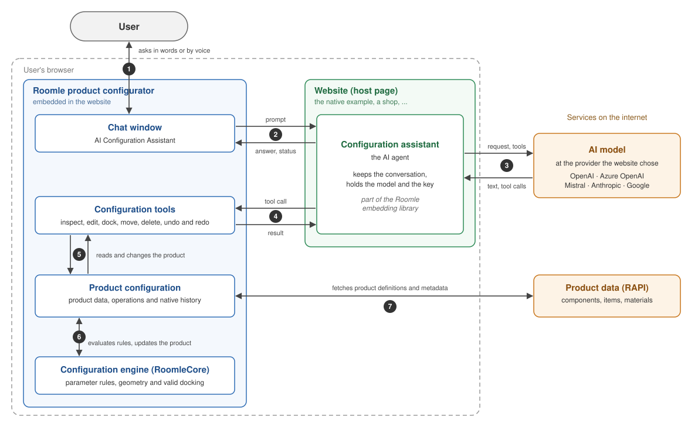

# How the AI Configuration Assistant Works

The AI Configuration Assistant is a chat window in the Roomle product configurator. The user
describes how they want to change a product, and an AI agent inspects and edits the live
configuration. It can answer questions about available options, change parameters and add, move
or remove components when the product supports those operations.

This page explains the parts of the assistant, where they run and what happens when the user
sends a request. It is an overview for anyone evaluating or integrating the assistant.
The [technical reference](../.agents/context/configurator-assistant-architecture.md)
covers implementation details.

The standalone native product example is [the example in this repository](../README.md).
For room planning with HOMAG Intelligence furniture groups, see the
[HI example](https://github.com/roomle-dev/roomle-hi-example/blob/master/README.md) and its
[AI Planning Assistant overview](https://github.com/roomle-dev/roomle-ui/blob/master/packages/embedding-lib/docs/planning-assistant-overview.md).

## At a glance

- **It works on the product the user sees.** The assistant reads and changes the active
  configuration in the browser.
- **The website chooses the AI model.** An embedding website supplies its provider, model and
  credentials. The configurator can also start its own browser agent from its integration settings.
- **The configurator supplies the tools and product knowledge.** Available choices come from
  product definitions and the configuration engine.
- **Edits use native undo and redo.** The assistant follows the same configuration history as
  the UI, including changes the user makes by hand.

## The components

| Component | Runs in | Role |
|---|---|---|
| **Chat window** | The configurator | Accepts the user's request and shows the streamed answer and current activity |
| **Website (host page)** | The browser | Embeds the configurator and starts the assistant with the model it has chosen |
| **Configuration assistant** | The website, or the configurator for UI-managed startup | Keeps the conversation, calls the AI model and runs the tools the model requests |
| **AI model** | The AI provider | Interprets the request, chooses tools and writes the answer. Host integrations support OpenAI, Azure OpenAI, Mistral, Anthropic and Google |
| **Configuration tools** | The configurator | Inspect the product, apply edits and navigate native undo/redo |
| **Product configuration** | The configurator | Resolves product data, applies operations, updates the scene and keeps native history |
| **Configuration engine (RoomleCore)** | The configurator | Evaluates component parameters, geometry, docking compatibility and placements |
| **Product data (RAPI)** | The internet | Supplies component definitions, item presets and material metadata |

### How the components interact

The numbers match the diagram, which shows an embedded configurator with the agent in its host page.

1. The user asks in the chat window and reads the answer there.
2. The window passes the request to the configuration assistant. The assistant returns streamed
   text, progress and completion to the window.
3. The assistant sends the conversation, instructions and tool definitions to the selected AI
   model. The model responds with text, tool requests or both.
4. The assistant forwards each tool request to the configurator and returns its result to the model.
5. The tools ask the configurator to read the current product or perform an operation.
6. The configuration engine evaluates the requested change, including parameter rules and docking,
   and the configurator updates the product and its native history.
7. The configurator fetches the component, item and material data it needs from RAPI.

Messages connect the embedded configurator and the host page. Inside the configurator, the tools
use its own APIs and engine directly. Product-data requests go from the configurator to RAPI.

An integration can instead let the configurator start the agent itself. The agent then runs
beside the tools in the configurator's browsing context. That startup uses OpenAI and the model
selected in the UI's integration settings. An embedding host can choose from the other supported
providers as well. One agent owns a chat window at a time.

### What the tools can do

The native tool set contains sixteen tools, grouped by purpose:

- **Inspect the product:** read the current configuration, component and global parameters, possible
  children, product capabilities and material information.
- **Find valid placements:** ask the engine where a new component can dock or where an existing
  component can move, including supported insert positions.
- **Check a deletion:** find out whether a component is deletable and which components would be
  removed, with or without attempting to dock its children back to the parent.
- **Change the configuration:** set parameters, dock a new component, move or delete an existing
  component, or replace the current configuration with a supplied configuration.
- **Undo and redo:** navigate the native configurator history.

The tools distinguish declared product alternatives from choices that are valid in the current
configuration. For an addition or a move, the engine calculates docking candidates and the agent
uses a returned placement. The model does not invent docking positions.

Product discovery can return useful information even when some catalog resources are unavailable.
The result identifies what is unresolved, and the assistant must acknowledge those gaps.

## What happens when the user sends a request

For a modular product that supports the operation, take the request
"Add another module with the same finish":

1. **The window opens a turn.** It displays the request, marks the assistant as working and passes
   the message to the browser agent.
2. **The model reads the request.** The agent sends the model the instructions, conversation so far,
   new message and available tools.
3. **The model inspects the product.** It reads the current configuration and finish, checks the
   available children and asks for valid docking placements. The window shows the running tools.
4. **The model requests an edit.** It chooses a supported module and a placement returned by the
   engine, then asks a tool to dock it. It can read and change the new component's finish when needed.
5. **The configurator applies the operation.** Native product rules evaluate the request. A changed
   edit records a history step; an unchanged value creates no step.
6. **The result returns to the model.** It reports the new component and whether the edit was
   confirmed, together with undo/redo availability. The model can inspect the result and continue
   with another operation if the request needs one.
7. **The model answers.** It describes the outcome from the tool results. Text appears as it is
   written, and the window becomes ready for the next request.

A single request can perform several edits and therefore create several undo steps. Undo follows
the latest configuration change, whether the assistant or the user made it.

A turn has at most sixteen model steps, with the last reserved for an answer, and a five-minute
deadline. If a turn fails or is interrupted, the window reports the known tool outcomes.
Completed edits remain in the configuration. A pending or unconfirmed edit may need inspection;
the assistant does not automatically repeat it. Ending a turn does not roll back an operation
already sent to the configurator.

## Why it is built this way

- **The product stays live.** The agent and the user work on the same configuration and see the
  results in the same scene.
- **Product rules remain authoritative.** The engine evaluates parameters and docking; the model
  chooses from the information returned by the tools.
- **The integration owns its AI choice.** The website or UI deployment selects its model and
  credentials.
- **Tools ship with the configurator.** Improvements to product inspection and editing reach
  integrations with compatible configurator updates.
- **Native history stays consistent.** Manual edits and assistant edits share the same undo/redo
  controls.

## Security and privacy

- **Provider credentials are visible in the browser.** The browser agent uses the credentials
  supplied by the integration. A production website chooses its authentication and provider-proxy
  arrangement.
- **Product information goes to the selected AI provider.** Requests can include the current
  configuration, returned product options and the conversation. Enabled image input also sends
  the user's attached image.
- **The example has no external MCP endpoint.** Its tools use MCP-shaped definitions and results
  over the existing SDK connection. An external application cannot connect to the example as an
  MCP server.

## Limits

- The tools need an active native configuration. The choices and operations available depend on
  that product's definitions.
- One request runs at a time, and the browser tab must stay open while the assistant works.
- The conversation belongs to the running page. Reloading starts a new conversation; preserving
  the product follows the website's normal configuration-saving behavior.
- The shared chat supports image input when the integration enables it and the model reads images.
  The standalone native example and UI-managed startup leave image input disabled.
- Voice input depends on browser speech recognition.
- A planner integration can explicitly route the assistant to a native object being configured
  in isolation. It does not automatically switch between native product editing and HI room planning.
- The integration needs a compatible configurator UI and embedding library. Showing the chat
  window alone does not start a usable agent.

## Further reading

- [Native configurator example and setup](configurator-assistant.md):
  run the standalone example with a model.
- [Native assistant integration](https://github.com/roomle-dev/roomle-ui/blob/feat/configuration-assistant/packages/embedding-lib/docs/configurator-assistant.md):
  connect the host or configure UI-managed startup.
- [Technical reference](../.agents/context/configurator-assistant-architecture.md):
  ownership, loading, forwarding and history.
- [How the AI Planning Assistant works](https://github.com/roomle-dev/roomle-ui/blob/master/packages/embedding-lib/docs/planning-assistant-overview.md):
  the companion overview for HI room planning.
