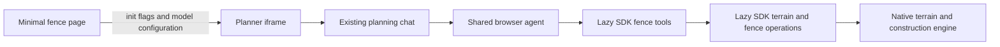

# Fence Assistant

The minimal fence page embeds the native Roomle planner with the Biohort catalog and
an outdoor terrain snapshot. With a model/key, the planner UI runs a terrain and fence
Fence Assistant using the shared Configuration Assistant / HI planning agent architecture.



## Run with the assistant

```sh
npm run dev:fence -- gpt-6-luna YOUR_OPENAI_API_KEY
```

Run a matching local roomle-ui on port 5173 first. `EXAMPLE_SERVER_URL` selects another
UI; `EXAMPLE_PORT` selects the page port. Without model arguments the example remains
a normal fence planner. The public embedding-library pin is unchanged because the
UI owns this assistant's startup; no new embedding package is published by this work.

The launcher serves `{ model, apiKey }` on a loopback-only, Host-checked, no-store
endpoint. The page fetches it before creating the planner and passes:

```js
{
  featureFlags: { planningAssistant: true, fence: true },
  apiKey,
  planningAiModel: model
}
```

Automatic activation requires both flags and a non-empty trimmed key. The UI imports
its optional fence adapter and model on demand. The page starts no host-side agent
and implements no tools, schemas or terrain geometry. Keep keys out of URL parameters.
Automatic UI startup uses OpenAI; the optional embedding fence adapter supports the
shared runtime's other providers when a host owns startup instead.

## Terrain tools

Four reads discover capabilities, current terrain topology, native height samples and
edit impact. Eleven writes load a plan, create terrain, move a terrain node, set shared
node height, set independent corner heights, translate patch level, split terrain,
change material, remove terrain, undo and redo.

Terrain coordinates are millimetres, with X/Y horizontal and Z up; projected areas
are mm2. IDs are live native runtime IDs, not XML UIDs. Re-read after loading or topology
changes. A shared node seed and a patch's effective corner height can differ. Flatten
by setting all corners to the same effective height; changing level preserves slopes.

The SDK assembles JSON context and orchestrates edits in dynamically imported
TypeScript modules. Core adds only typed terrain/construction contours, exact construction placement, an undo-aware
independent corner setter, and thin bindings for existing reads. Existing native topology,
triangulation, sampling, persistence and construction distribution remain authoritative.

## History, compatibility and limits

Edits use ordinary planner history, including manual edits. A batch of corner edits is
one step; a no-op creates no step. Loading replaces the plan and resets history. The
result reports actual terrain, history, corrections and uncertain outcomes. Saving to
RAPI is separate.

Use matching UI and Core builds. Older deployments can lack the new methods; query
capabilities rather than assuming support. Straight terrain outlines and slopes/steps
are supported. Curve authoring, curved-patch splitting, DEM import are outside this version. Existing curved boundaries
are retained in reads.

Terrain-only edits complete at the normal interaction boundary. With potentially
affected construction objects, results conservatively report construction `pending`
and `confirmed: false`: there is no aggregate native dependent-batch completion result.
Native fence redistribution still runs. Do not treat a save or a successful terrain
edit as proof that every fence geometry/BOM update finished, and do not replay an
uncertain write automatically.

The UI API reference is in roomle-ui at
`packages/web-sdk/packages/planner-core/docs/fence-operations.md`; embedding integration
is in `packages/embedding-lib/docs/fence-assistant-overview.md`.
See the [example guide](../minimla-fence-example/README.md) for exports and launch options.

## Fence authoring

The same lazy operation module provides nine construction writes:

| Operation | Payload |
|---|---|
| `createFence` | `{ productId, vertices: [{ x, y }], closed?, parameters?: [{ key, value }] }` |
| `extendFence` | `{ fromNodeId, vertices: [{ x, y }] }` |
| `moveFenceNode` | `{ nodeId, position: { x, y } }` |
| `setFenceEdgeLength` | `{ edgeId, length, measurement: 'projected' or 'sloping', fixedEndpoint: 'from' or 'to' }` |
| `setFenceParameter` | `{ scope, key, value }` |
| `placeFenceObject` | `{ productId, edgeId, distanceFromStart, parameters? }` |
| `moveFenceObject` | `{ objectId, edgeId, distanceFromStart }` |
| `removeFence` | `{ scope }` |
| `removeFenceObject` | `{ objectId }` |

A scope names `{ edgeId }` or `{ objectId, part? }`. The default selects the
connected fence; `part: true` selects one object's native parameters. Removal accepts
only complete connected fences. Independent object removal requires native permission.
Generated parts can have an empty item ID; classification uses native categories and
cached construction rules.

Five reads extend the terrain queries: `fences`, `fenceProducts`, `fenceParameters`,
`fenceEditImpact` and `constructionOverview`. Fence context contains native nodes,
edges, attachment incidence, objects, cached rules, groups and history. It distinguishes
planner IDs, configuration IDs and root component IDs. Parameter `objectIds` are native
configuration IDs; `plannerObjectIds` map them to planner objects. Whole-fence reads use
native merged parameters, including contour globals hidden in individual part views.
Read choices again after each dependent change. Material groups are resolved through
RAPI; unavailable choices are explicit partial results.

Product discovery traverses visible tags under `catalogRootTag`, accepts search and
pagination, and reads declared component roles without inserting products. Declared
metadata is a discovery hint; a loaded seed must have native distributable rules.
The SDK applies ordered initial parameters before drawing the contour. Existing-node
extension reuses the loaded pattern without inserting another seed.

Gate/external placement targets the exact straight edge. `distanceFromStart` uses
millimetres along the directed edge from its geometry anchor. Native fitting can adjust
the station on that edge; results report the actual attachment and correction. Failure
never chooses another nearby edge silently. All coordinates use kernel XY and Z up.

Construction writes use the shared interaction manager's owned native operation and
ordinary tool-call history. Separate writers and manual edits are rejected while an
asynchronous operation owns the planner. Undo or plan replacement invalidates its late
mutations. A complete operation, including seed insertion, has one undo step; failures
can leave a partial, undoable result and must never be retried automatically.

Results include detached construction context, affected nodes/edges/objects and created/
removed object IDs. The initial product loader is awaited, but there is no aggregate
native completion barrier for dependent geometry and BOM updates. Such results remain
`construction: 'pending'` and `confirmed: false`; overview is a current plan-wide
snapshot, not a completion guarantee. No timer, polling loop, backend save or first mesh
is used as proof of completion.

The Core dependency consists of programmatic construction contours, exact object
placement and thin rule/station/iterable attachment bindings. Distribution, free-span
fitting, terrain anchoring and exports use existing native implementations. Curved
authoring, branch-subset removal, family replacement and explicit joining doors remain
outside this contract; existing curves are retained in reads.

Parameter writes return effective native `parameters` and dependent choices. Terrain
edits report actual construction object creation/removal alongside their conservative
affected-object list and current construction context.
