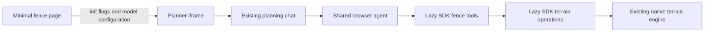

# Fence Assistant

The minimal fence page embeds the native Roomle planner with the Biohort catalog and
an outdoor terrain snapshot. With a model/key, the planner UI runs a terrain-focused
Fence Assistant using the shared Configuration Assistant / HI planning agent architecture.



## Run with the assistant

```sh
npm run dev:fence -- gpt-6-luna YOUR_OPENAI_API_KEY
```

Run a matching local roomle-ui on port 5173 first. `EXAMPLE_SERVER_URL` selects another
UI; `EXAMPLE_PORT` selects the page port. Without model arguments the example remains
a normal fence planner. The public embedding-library pin is unchanged because the
UI owns this assistant's startup; no new embedding package is published by this work.

The launcher serves `{ model, apiKey }` on a loopback-only, Host-checked, no-store
endpoint. The page fetches it before creating the planner and passes:

```js
{
  featureFlags: { planningAssistant: true, fence: true },
  apiKey,
  planningAiModel: model
}
```

Automatic activation requires both flags and a non-empty trimmed key. The UI imports
its optional fence adapter and model on demand. The page starts no host-side agent
and implements no tools, schemas or terrain geometry. Keep keys out of URL parameters.
Automatic UI startup uses OpenAI; the optional embedding fence adapter supports the
shared runtime's other providers when a host owns startup instead.

## Terrain tools

Four reads discover capabilities, current terrain topology, native height samples and
edit impact. Eleven writes load a plan, create terrain, move a terrain node, set shared
node height, set independent corner heights, translate patch level, split terrain,
change material, remove terrain, undo and redo.

Terrain coordinates are millimetres, with X/Y horizontal and Z up; projected areas
are mm2. IDs are live native runtime IDs, not XML UIDs. Re-read after loading or topology
changes. A shared node seed and a patch's effective corner height can differ. Flatten
by setting all corners to the same effective height; changing level preserves slopes.

The SDK assembles JSON context and orchestrates edits in dynamically imported
TypeScript modules. Core adds only typed contour construction, an undo-aware independent
corner setter, and thin bindings for existing reads. Existing native topology,
triangulation, sampling, persistence and construction distribution remain authoritative.

## History, compatibility and limits

Edits use ordinary planner history, including manual edits. A batch of corner edits is
one step; a no-op creates no step. Loading replaces the plan and resets history. The
result reports actual terrain, history, corrections and uncertain outcomes. Saving to
RAPI is separate.

Use matching UI and Core builds. Older deployments can lack the new methods; query
capabilities rather than assuming support. Straight terrain outlines and slopes/steps
are supported. Curve authoring, curved-patch splitting, DEM import and fence-product
creation tools are outside this terrain-focused version. Existing curved boundaries
are retained in reads.

Terrain-only edits complete at the normal interaction boundary. With potentially
affected construction objects, results conservatively report construction `pending`
and `confirmed: false`: there is no aggregate native dependent-batch completion result.
Native fence redistribution still runs. Do not treat a save or a successful terrain
edit as proof that every fence geometry/BOM update finished, and do not replay an
uncertain write automatically.

The UI API reference is in roomle-ui at
`packages/web-sdk/packages/planner-core/docs/fence-operations.md`; embedding integration
is in `packages/embedding-lib/docs/fence-assistant-overview.md`.
See the [example guide](../minimla-fence-example/README.md) for exports and launch options.
